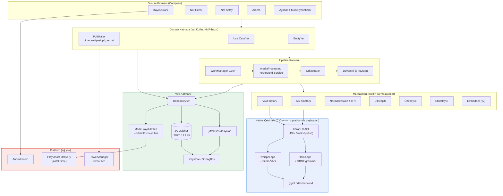
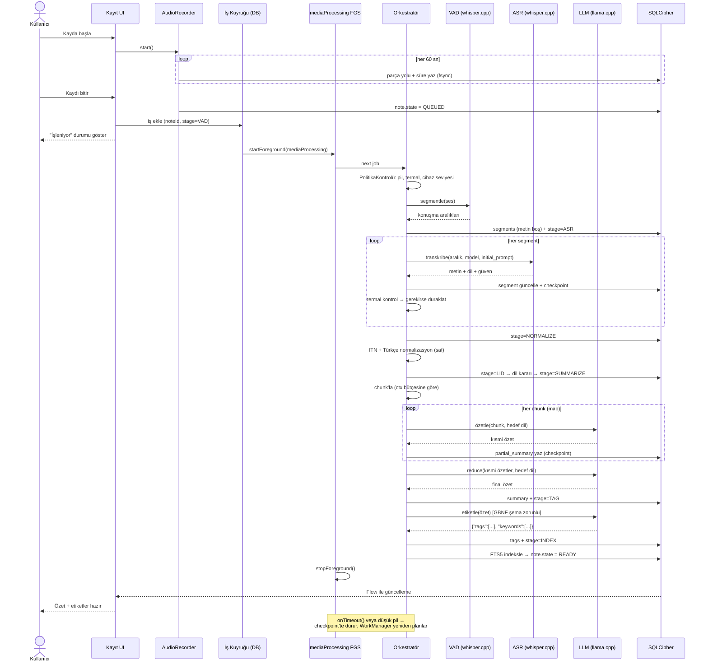
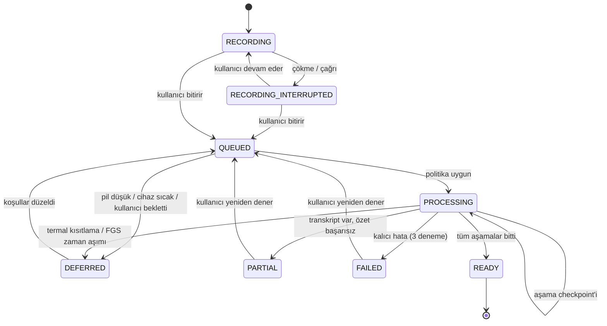
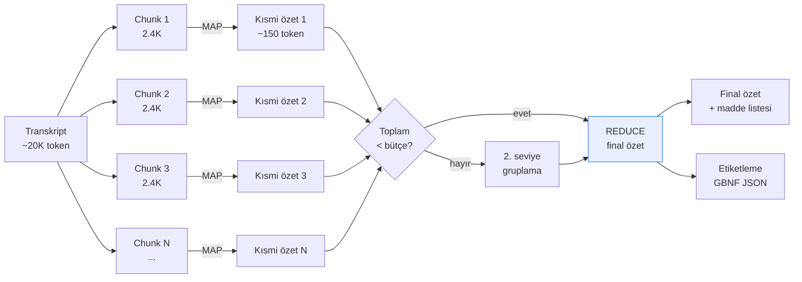
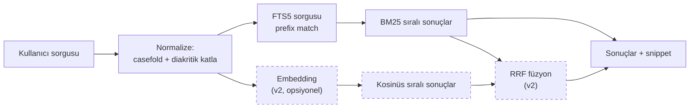
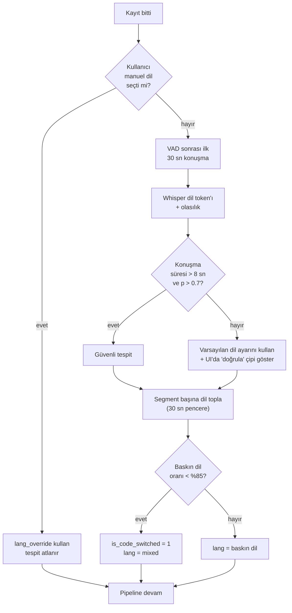
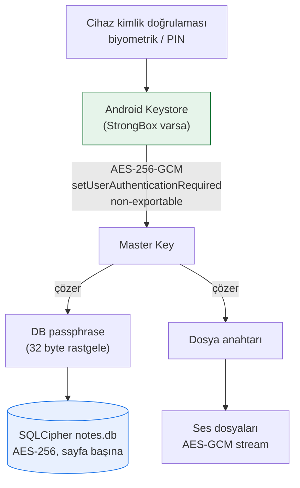
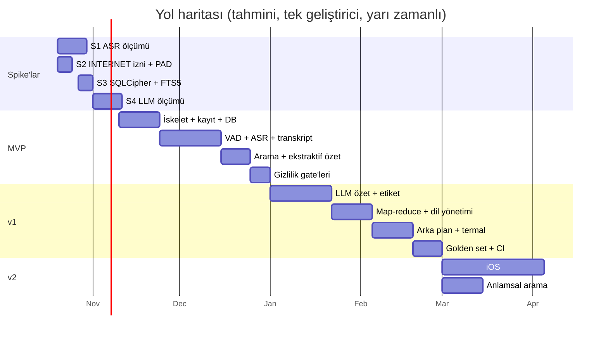

# Offline Sesli Not Uygulaması — Mimari Doküman

> **Durum:** Taslak v0.2 — mimari onaylandı, spike aşamasında
> **Tarih:** 17 Ekim 2026
> **Kapsam:** Tamamen cihaz üstünde (on-device) çalışan, internetsiz sesli not uygulamasının mimarisi
> **Not:** Tam uygulama kodu S1–S4 spike'ları tamamlanmadan yazılmayacak. Kod örnekleri yalnızca niyeti göstermek için kısa tutuldu.

### Değişiklik günlüğü

| Sürüm | Değişiklik |
|---|---|
| v0.2 | **S11 kapandı:** Silero VAD = MIT (doğrulandı). **S12 kapandı:** Jetpack Security Crypto deprecated → **Google Tink** kararı (ADR-005 güncellendi). **V11 kapandı:** gerçek Play limitleri bulundu — install-time toplam **4 GB** → ADR-004 belirgin şekilde güçlendi. **V12 kapandı:** Qwen3-1.7B Apache-2.0 doğrulandı (ama model kartı Türkçe'yi ismen saymıyor → V6 riski arttı). **V1 kapandı:** Mac yok, iPhone yalnızca referans cihaz; iOS cihaz tabanı §2.1 olarak eklendi. **V2 kapandı:** 4–6 GB orta segment Android test cihazı var → ölçümler hedef kitlede yapılabilir. |
| v0.1 | İlk taslak |

---

## İçindekiler

1. [Ürün tanımı ve kısıtlar](#1-ürün-tanımı-ve-kısıtlar)
2. [Netleştirilen kararlar ve varsayımlar](#2-netleştirilen-kararlar-ve-varsayımlar)
3. [Model ve kütüphane araştırması](#3-model-ve-kütüphane-araştırması)
4. [Mimari genel görünüm](#4-mimari-genel-görünüm)
5. [Uçtan uca pipeline](#5-uçtan-uca-pipeline)
6. [Uzun kayıtlar: chunk'lama ve map-reduce özetleme](#6-uzun-kayıtlar-chunklama-ve-map-reduce-özetleme)
7. [Arka plan işleme, pil ve termal yönetim](#7-arka-plan-işleme-pil-ve-termal-yönetim)
8. [Platform ve teknoloji seçimi](#8-platform-ve-teknoloji-seçimi)
9. [Modül yapısı ve klasör ağacı](#9-modül-yapısı-ve-klasör-ağacı)
10. [Veri modeli](#10-veri-modeli)
11. [Arama mimarisi](#11-arama-mimarisi)
12. [Çift dil (TR + EN) tasarımı](#12-çift-dil-tr--en-tasarımı)
13. [Gizlilik ve güvenlik](#13-gizlilik-ve-güvenlik)
14. [Kalite ölçümü ve hedef metrikler](#14-kalite-ölçümü-ve-hedef-metrikler)
15. [Yol haritası](#15-yol-haritası)
16. [ADR'ler](#16-adrler)
17. [Riskli noktalar — spike listesi](#17-riskli-noktalar--spike-listesi)
18. [Açık sorular ve doğrulanmamış varsayımlar](#18-açık-sorular-ve-doğrulanmamış-varsayımlar)
19. [Kaynaklar](#19-kaynaklar)

---

## 1. Ürün tanımı ve kısıtlar

Kullanıcı ses kaydeder; ses **cihazda** yazıya çevrilir, özetlenir ve otomatik etiketlenir. Hiçbir veri (ses, metin, metadata, analytics) cihazdan çıkmaz.

### Kesin kısıtlar

| # | Kısıt | Mimari sonucu |
|---|---|---|
| K1 | Çekirdek işlevler uçak modunda çalışmalı | Tüm ASR/LLM/arama yerel; ağ çağrısı yok |
| K2 | Bulut API'si, analytics, crash reporting SDK'sı yok | Bağımlılık allowlist'i + CI'da yasaklı API kontrolü |
| K3 | Model dağıtımı gizlilik vaadini bozmamalı | Play Asset Delivery (ADR-004); uygulamada `INTERNET` izni **yok** |
| K4 | Orta segment hedef (4–6 GB RAM Android, iPhone 12+) | Katmanlı model seviyeleri + ekstraktif fallback |
| K5 | Tüm veriler cihazda şifreli | SQLCipher + Keystore/Keychain (ADR-005) |

---

## 2. Netleştirilen kararlar ve varsayımlar

Sorduğum sorulara verilen cevaplar ve bunların mimariye etkisi:

| Soru | Cevap | Mimari etkisi |
|---|---|---|
| MVP platformu | **Android öncelikli** | Kotlin + native; iOS v2'ye. C/C++ çekirdek iki platformda paylaşılacak şekilde tasarlanır |
| Maksimum kayıt süresi | **≤ 60 dk** | Chunk'lama + map-reduce özetleme **zorunlu**; checkpoint'li kuyruk gerekli |
| Transkripsiyon zamanı | **Kayıt sonrası (batch)** | Streaming ASR yok → daha büyük/doğru model kullanılabilir; kayıt sırasında pil/termal riski yok |
| En düşük OS tabanı | **Android 12+ (API 31) / iOS 17+** | Gemini Nano ve Apple Foundation Models **ana yol olamaz**; kendi taşınabilir modellerimiz tek doğruluk kaynağı |

### Açık varsayımlar

> **V1 — ✅ KAPANDI (17 Eki 2026): Mac yok.** Kullanıcı doğruladı. Xcode yalnızca macOS'ta çalıştığı için eldeki iPhone **test cihazı değil, referans cihazdır** — kendi build'imizi o cihaza kuramayız. iOS kesin olarak v2'ye alındı ve v2'nin **ön koşulu bir Mac'e erişimdir** (§15). Bu, ADR-001'in native-first kararını zayıflatmıyor, güçlendiriyor: iOS UI'ı yazılamadığı dönemde Flutter/RN'in kod paylaşımı avantajı zaten kullanılamaz.
>
> **V2 — ✅ KAPANDI (17 Eki 2026): 4–6 GB RAM'li orta segment Android cihaz var.** Bu, mimarinin ölçüme dayanan iddialarını (S1, S3, S4, S7) **doğrudan hedef kitlede** doğrulayabileceğimiz anlamına geliyor — mümkün olan en iyi durum. Emülatör bu ölçümler için geçersizdir (GPU/NPU backend'leri, gerçek bellek baskısı ve özellikle termal kısıtlama taklit edilemez), o yüzden tüm benchmark'lar bu cihazda koşacak. **Yapılacak:** cihazın tam modeli, SoC'si ve RAM'i §14.3'ün başına "referans cihaz" olarak yazılmalı — hedef metrikler ancak belirli bir cihaza bağlandığında anlam taşır.
>
> **V3 — Tek kullanıcı, tek cihaz.** Senkronizasyon, çok cihaz, paylaşım yok. Bu, şifreleme ve veri modelini ciddi şekilde sadeleştiriyor.

### 2.1 iOS cihaz tabanı — neden cihaz listesi değil, çalışma zamanı kontrolü

Cihaz tabanını "iPhone 11 ve sonrası" gibi bir **liste** olarak ifade etmek cazip ama yanıltıcı. Nedeni:

| Cihaz | Çip | RAM | iOS 26? |
|---|---|---|---|
| iPhone XR / XS | A12 | 3 GB | ❌ iOS 26 desteklemiyor |
| **iPhone SE (2. nesil)** | **A13** | **3 GB** ⚠️ | ✅ destekliyor |
| iPhone 11 | A13 | 4 GB | ✅ |
| iPhone 12 | A14 | 4 GB | ✅ |
| iPhone SE (3. nesil) | A15 | 4 GB | ✅ |

**Tuzak:** "A13 ve sonrası" demek 4 GB RAM garantisi vermiyor — **iPhone SE 2. nesil A13'e sahip ama 3 GB RAM'li** ve iOS 26 tarafından destekliyor. Yani çip veya model listesi, bizim gerçekten önemsediğimiz şeyi (kullanılabilir bellek) ölçmüyor.

**Karar:** iOS'ta cihaz uygunluğu **çalışma zamanında** belirlenir:

```swift
// Model yüklemeden ÖNCE sorulacak tek soru: şu an ne kadar belleğim var?
let available = os_proc_available_memory()          // byte
let tier = DeviceTier.resolve(availableBytes: available)
// tier: .low → ekstraktif özet, .mid → 1.7B model, .high → daha büyük model
```

| Konu | Karar |
|---|---|
| OS tabanı | **iOS 17** (erişim için), ancak özellik uygunluğu OS sürümüne değil belleğe bağlı |
| Cihaz tabanı | **Liste yok.** `os_proc_available_memory()` ile seviye belirlenir |
| 4 GB cihazlarda bütçe | iOS uygulama başına yerleşik bellek sınırı uygular; aşılırsa **jetsam** süreci öldürür. 4 GB'lık bir cihazda bu sınır ~2 GB mertebesindedir ⚠️ **doğrulanmamış, Mac olmadan ölçülemez** |
| `com.apple.developer.kernel.increased-memory-limit` | Varsayılan sınırın üstüne çıkmayı talep eder, **yalnızca destekleyen cihazlarda**. Apple dokümanı "ekstra bellek yoksa uygulama doğru çalışmaya devam etmeli" diyor → buna bel bağlanamaz. Ayrıca geliştirme build'inde çalışıp App Store build'inde çalışmadığına dair geliştirici raporları var ⚠️ |
| GGUF yükleme stratejisi | llama.cpp **mmap** kullanır → salt-okunur sayfalar bellek baskısında atılabilir. 4 GB cihazda 1.28 GB modeli ayakta tutmanın tek gerçekçi yolu bu |
| ASR + LLM eşzamanlılığı | **Asla aynı anda bellekte değil** — Android'de performans tercihi, iOS 4 GB'ta **hayatta kalma koşulu** |

> **Senin sorunun cevabı:** iPhone 11 vs iPhone 12 tabanı arasında RAM açısından **fark yok** (ikisi de 4 GB); fark A13 vs A14 (Neural Engine hızı) ve OS desteği ömründe. iPhone 11'i taban almak sana ~1 yıl daha fazla cihaz kazandırıyor ve RAM maliyeti yok — **mantıklı**. Ancak gerçek risk iPhone 11 değil, **3 GB'lık iPhone SE 2**: o cihazı bir listeyle dışlamak yerine çalışma zamanı kontrolüyle otomatik olarak düşük seviyeye düşürmek daha doğru. Böylece hiçbir cihazı gereksiz yere dışlamıyor, hiçbirinde de çökmüyoruz.

---

## 3. Model ve kütüphane araştırması

> ⚠️ **Uyarı:** Aşağıdaki tablolardaki hız ve RAM rakamlarının neredeyse tamamı **amiral gemisi cihazlarda, satıcı tarafından** ölçülmüştür (Samsung S24/S26 Ultra, iPhone 17 Pro). Hedefimiz orta segment. Kendi cihazınızda ölçmeden hiçbirini plan sayısı olarak kullanmayın. Kaynak ve doğrulama durumu her satırda işaretli.

### 3.1 ASR adayları

| Aday | TR kalitesi | EN kalitesi | Model boyutu | Tepe RAM | Hız (RTF) | Lisans | Mobil entegrasyon | Değerlendirme |
|---|---|---|---|---|---|---|---|---|
| **whisper.cpp** + Whisper `small` (multilingual, q5_1) | Orta-iyi ⚠️ ölçülmedi | İyi | ~180 MB (q5_1) ⚠️ yaklaşık | ~0.6–1.0 GB ⚠️ tahmin | ⚠️ ölçülmeli, 0.3–0.6 beklentisi | **MIT** | Kolay: JNI + CMake, ggml tek bağımlılık | **MVP için önerilen varsayılan** |
| **whisper.cpp** + `large-v3-turbo` (q5_0) | İyi ⚠️ ölçülmedi | Çok iyi | **547 MB** (q5_0), 834 MB (q8_0), 1.5 GB (f16) | ⚠️ ölçülmeli, >1.5 GB beklentisi | ⚠️ **kritik risk**, aşağıya bakın | MIT | Aynı runtime | Opsiyonel "yüksek doğruluk" seviyesi |
| **sherpa-onnx** (Whisper / Zipformer) | Whisper ile aynı; Zipformer TR modeli yok | İyi | Whisper ile aynı + onnxruntime ~15–20 MB/ABI | Benzer | int8'e kadar quantize (int4 yok) | **Apache-2.0** | Hazır Kotlin/Swift/Flutter binding'leri, VAD + noktalama + diarization dahil | Güçlü alternatif; ADR-002'de reddedilme gerekçesi var |
| **Vosk** (`vosk-model-small-tr`) | Zayıf-orta ⚠️ | Orta | ~40–50 MB ⚠️ TR için doğrulanmadı | Çok düşük | Çok hızlı, streaming | Apache-2.0 | Kolay, olgun Android API | Noktalama yok, code-switching yok → **reddedildi** |
| **NVIDIA Parakeet TDT v3** | ❌ **Türkçe yok** (25 Avrupa dili, TR listede değil) | Mükemmel, çok hızlı | ~600 MB | — | Çok iyi | CC-BY-4.0 ⚠️ | NeMo → ONNX dönüşümü gerekli | **Türkçe olmadığı için reddedildi** |
| **Apple SFSpeechRecognizer** (on-device) | Orta ⚠️ | İyi | OS'un içinde, 0 MB | Düşük | İyi | Platform | Sadece iOS | iOS'ta ücretsiz fallback olarak değerlendirilebilir (v2) |

#### ⚠️ `large-v3-turbo` hakkında kritik mimari içgörü

Turbo'nun hız kazancı **yalnızca decoder tarafında**: decoder 32 katmandan 4 katmana indirilmiş, **encoder large-v3 ile aynı** (32 katman, 1280 boyut). Sunucu GPU'sunda decode baskın maliyet olduğu için "6x hızlı" rakamı doğrudur; ancak **mobil CPU'da encoder baskın maliyettir**. Dolayısıyla:

> **Hipotez (S1 ile doğrulanmalı):** Mobil CPU'da `large-v3-turbo`, `large-v3`'e göre yalnızca ~1.5–2x hızlıdır, `small`'a göre ise **belirgin şekilde yavaş** kalır. 547 MB'lık dosya boyutu cazip görünse de orta segment cihazda 60 dakikalık kayıt için gerçek zamandan yavaş kalma riski yüksektir.

Ayrıca OpenAI'nin model kartı, turbo'nun dil başına bozulmasının bazı dillerde (Tayca, Kantonca örnek veriliyor) daha belirgin olduğunu söylüyor; kayıp genelde düşük kaynaklı dillerde artıyor. Türkçe için **ölçülmüş bir rakam bulamadım** — S1 spike'ının birincil amacı bu.

#### VAD

whisper.cpp **v1.8.3'ten beri Silero VAD'ı ggml formatında dahili olarak destekliyor** (`ggml-silero-v6.2.0.bin`). Bu, mimari açıdan önemli: ayrıca onnxruntime bağımlılığı eklemeden VAD elde ediyoruz.

- Model boyutu ~2 MB, 8 kHz ve 16 kHz, 512 örneklik pencere
- ✅ **Lisans doğrulandı (S11, 17 Eki 2026):** Upstream `LICENSE` dosyası **MIT License**, "Copyright (c) 2020-present Silero Team". README'deki bir badge'in alt metninde geçen `CC BY-NC 4.0` ifadesi eski/hatalı bir kalıntı — gerçek lisans MIT. Ticari kullanım ve portföy anlatısı için engel yok.

### 3.2 Özetleme + etiketleme (LLM) adayları

| Aday | TR kalitesi | Boyut (4-bit) | Tepe RAM | Hız | Lisans | Entegrasyon | Değerlendirme |
|---|---|---|---|---|---|---|---|
| **Qwen3-1.7B** Q4_K_M (GGUF) | ⚠️ ölçülmeli; model kartı "100+ dil ve diyalekt" diyor ama **Türkçe'yi ismen saymıyor** | **1.28 GB** | ⚠️ ~1.5–2.5 GB tahmin (ctx'e bağlı) | ⚠️ ölçülmeli | ✅ **Apache-2.0** (resmî kartta doğrulandı, V12) | llama.cpp + JNI; GBNF grammar hazır | **Varsayılan özetleyici önerisi.** 1.7B toplam / 1.4B embedding-dışı, 32.768 token ctx |
| **Gemma 3 1B IT** int4 QAT (`.task`) | ⚠️ 1B sınıfı için zayıf beklentisi | **529 MB** | 1138 MB (CPU, ctx 2048, **S24 Ultra**) | prefill 322 tk/s, decode 47 tk/s (CPU, S24 Ultra); GPU 2585 / 56 | **Gemma Terms** (Apache değil) | LiteRT-LM / MediaPipe; HF'de erişim onayı gerekli | Düşük segment seviyesi; lisans portföy için dezavantaj |
| **Gemma 4 E2B** (`.litertlm`) | ⚠️ ölçülmeli; "35+ dil out-of-the-box, 140+ dilde ön eğitim" (TR ismen listelenmiyor) | **2.58 GB** | 1733 MB CPU / 676 MB GPU (**S26 Ultra**) | prefill 557 / decode 47 tk/s (CPU); GPU 3808 / 52 | **Apache-2.0** ✅ | LiteRT-LM; GBNF yok | Yüksek seviye (8 GB+ cihaz); boyut MVP için ağır |
| **Gemma 4 E4B** | Daha iyi beklentisi | 3.65 GB | 3283 MB CPU (S26 Ultra) | prefill 195 / decode 18 tk/s CPU | Apache-2.0 | LiteRT-LM | **Orta segment için reddedildi** (RAM) |
| **Qwen3-4B** Q4_K_M | Daha iyi beklentisi | 2.50 GB | ~3 GB+ | — | Apache-2.0 | llama.cpp | Yüksek seviye alternatifi |
| **Kızagan-E4B-Turkish** (Gemma 4 E4B fine-tune) | TR SFT yapılmış; kendi tablosunda TR MMLU 30.4 → 33.2 (küçük artış) | ~3.65 GB sınıfı | Yüksek | — | Apache-2.0 | GGUF dönüşümü gerekli | İlginç ama boyut uygun değil; **v2'de değerlendir** |
| **Kumru-2B** (VNGRS, sıfırdan Türkçe) | ⚠️ ölçülmeli — en umut verici TR adayı | ~1.2–1.5 GB tahmin | ⚠️ | — | Apache-2.0 ⚠️ doğrulanmalı | GGUF dönüşümü gerekli | **S4'te Qwen3-1.7B ile yan yana test edilmeli** |
| **ML Kit GenAI Summarization** (Gemini Nano) | ❌ **Türkçe yok** — resmî doküman yalnızca EN/JA/KO listeliyor | 0 (AICore'da) | 0 | Hızlı | Platform | API 26+, bootloader kilitli olmalı, 4000 token sınırı | **Türkçe olmadığı için reddedildi** |
| **Apple Foundation Models** | TR Eylül 2025 lansman listesinde **yok**; iOS 26.1'de desteklendiği bir geliştirici kaynağında bildiriliyor ⚠️ | 0 | 0 | Hızlı | Platform | iOS 26 + Apple Intelligence donanımı | iOS 17 tabanıyla çelişiyor → **v2'de opsiyonel hızlandırıcı** |

#### Kritik bulgu: platform yerleşik modelleri Türkçe için kullanılamıyor

- **Android / ML Kit GenAI Summarization:** Resmî dokümanda desteklenen diller **İngilizce, Japonca, Korece**. Türkçe yok. Ek kısıtlar: girdi < 4000 token, makale > 400 karakter, bootloader kilidi açık cihazlarda çalışmıyor, AICore model indirmesi "dakikalar–saatler" sürebiliyor.
- **iOS / Apple Foundation Models:** Apple'ın Eylül 2025 duyurusundaki 9 dilde Türkçe yok. Bir geliştirici kaynağı iOS 26.1'de 23 locale arasında TR'yi listeliyor, ancak Apple'ın bunu hangi sürümde eklediğine dair resmî bir doküman bulamadım. Her durumda çalışma zamanında `SystemLanguageModel.default.supportedLanguages` kontrol edilmeli, statik liste varsayılmamalı.

**Sonuç:** Yerleşik platform modelleri **ana yol olamaz** (ADR-003). Kendi taşınabilir modelimiz tek doğruluk kaynağıdır; yerleşik modeller yalnızca feature-flag arkasında opsiyonel hızlandırıcı olabilir.

### 3.3 Embedding (anlamsal arama, opsiyonel)

| Aday | Diller | Boyut | RAM | Lisans | Not |
|---|---|---|---|---|---|
| **EmbeddingGemma** (308M) | 100+ | ~200 MB quantize | <200 MB (satıcı beyanı) | Gemma Terms | 768→128 MRL boyut kesme; v2 için uygun |
| **EmbeddingGemma 2** (740M, multimodal) | Benzer multilingual kalite | — | metin-only 191 MB, tam 567 MB (Pixel 11 Pro, satıcı beyanı) | Gemma Terms ⚠️ | Gemma 4 decoder tabanlı; aşırı kapsamlı |

### 3.4 Çalışma zamanı ve depolama bileşenleri

| Bileşen | Sürüm | Lisans | Not |
|---|---|---|---|
| **whisper.cpp** | v1.9.5 (6 Eki 2026) | MIT | ggml; dahili Silero VAD v6.2.0; Vulkan/OpenCL backend'leri var ama mobilde olgunluk ⚠️ |
| **llama.cpp** | master | MIT | ggml; **GBNF grammar + JSON Schema → grammar dönüşümü** (ADR-007'nin temeli) |
| **SQLCipher for Android** | AAR 4.19.1 | ✅ **BSD-3-Clause** (Copyright ZETETIC LLC) | FTS5 3.4.0'dan beri destekliyor ⚠️ 4.19.1'de `PRAGMA compile_options` ile doğrulanmalı (S3); Room ile entegrasyon dokümante. **Telif bildirimi ikili dağıtımda kullanıcıya ulaşmalı** → açık kaynak lisans ekranı gerekiyor |
| **Google Tink** (dosya şifreleme) | güncel | Apache-2.0 | **S12 kararı.** Streaming AEAD ile ses dosyaları şifrelenir. `androidx.security:security-crypto` **deprecated** olduğu için onun yerine geçiyor |
| ~~`androidx.security:security-crypto`~~ | 1.1.0 | Apache-2.0 | ❌ **Kullanılmayacak.** Tüm API'ler 1.1.0'da deprecated, yeni sürüm planı yok. `EncryptedFile` için resmî öneri `java.io.File` (yani "kendin çöz"), anahtar için `KeyGenerator` + AndroidKeyStore |
| **Zemberek-NLP** (morfoloji) | 0.17.1 (2019) | Apache-2.0 | Yavaş bakım modunda; TR lemmatizasyon için en olgun seçenek (S9) |
| **WorkManager** | ≥ 2.10 | Apache-2.0 | `onTimeout` desteği 2.10'dan itibaren — **2.9 ile uygulama çöküyor** |
| **WhisperKit / argmax-oss-swift** | v1.1.1 (8 Eki 2026) | MIT ⚠️ (yalnızca agregatör kaynağı) | iOS 17+/macOS 14+; v2 için iOS ASR adayı |

---

## 4. Mimari genel görünüm

### 4.1 Bileşen diyagramı



### 4.2 Katman kuralları

| Kural | Gerekçe |
|---|---|
| `domain` hiçbir Android/iOS API'si import etmez | v2'de KMP'ye taşımanın ön koşulu; JVM'de hızlı test |
| `ml:*` sarmalayıcıları yalnızca `native` C API'sini görür | Runtime değiştirmek (whisper.cpp → sherpa-onnx) tek modülü etkiler |
| `pipeline` yalnızca `domain` arayüzlerine bağlıdır | Orkestrasyon mantığı emülatörsüz test edilebilir |
| Ses/metin verisi hiçbir zaman log'a yazılmaz | Release'te lint kuralı ile zorlanır (bkz. §13) |
| Hiçbir modül `java.net`, `okhttp`, `retrofit` kullanamaz | CI'da yasaklı API taraması |

---

## 5. Uçtan uca pipeline

### 5.1 Aşama tablosu

| # | Aşama | Girdi | Çıktı | Hata durumları | Yarıda kalırsa |
|---|---|---|---|---|---|
| 1 | **Kayıt** | Mikrofon | 60 sn'lik WAV parçaları (16 kHz mono PCM16) + `note` satırı | Mikrofon izni yok, cihaz dolu, başka uygulama mikrofonu aldı, çağrı geldi | Her 60 sn'lik parça diske yazıldığı için çökme en fazla son parçayı kaybeder; not `RECORDING_INTERRUPTED` ile açılır, kullanıcı devam/bitir seçer |
| 2 | **VAD / segmentleme** | WAV parçaları | Konuşma aralıkları `[start_ms, end_ms]` | Hiç konuşma bulunamadı (sessiz kayıt), VAD modeli eksik | İdempotent: tüm dosya üzerinden yeniden çalışır, maliyeti düşük (<2 MB model, gerçek zamanın ~%1'i) |
| 3 | **ASR** | Konuşma aralıkları + ses | `segment` satırları (metin, zaman damgası, güven, dil) | OOM, model dosyası bozuk, cihaz çok ısındı, FGS bütçesi bitti | **En pahalı aşama.** Her segment bitince DB'ye yazılır → `last_completed_segment_index` ile tam olarak kaldığı yerden devam eder |
| 4 | **Normalizasyon + ITN** | Segment metinleri | Normalize metin + görüntüleme metni | Belirsiz sayı/tarih formatı | Saf fonksiyon, deterministik → her zaman yeniden çalıştırılabilir |
| 5 | **Dil tespiti / doğrulama** | Segment dilleri + kullanıcı tercihi | Not dili + baskın dil + karışık dil bayrağı | Kısa kayıtta güvensiz tespit | Yeniden çalıştırılabilir; kullanıcı manuel geçersiz kılarsa aşama atlanır |
| 6 | **Chunk'lama** | Tam transkript | Chunk listesi (token sınırlı, VAD sınırlarında) | Transkript boş | Deterministik, DB'de saklanmaz (gerektiğinde yeniden üretilir) |
| 7 | **Özetleme (map-reduce)** | Chunk'lar | Kısmi özetler → final özet | OOM, dil kayması, model yanıt vermiyor, bağlam aşımı | Her kısmi özet DB'ye yazılır → reduce aşaması yeniden çalışırken map tekrar edilmez |
| 8 | **Etiketleme** | Final özet + transkript başı | Kanonik etiketler + anahtar kelimeler (GBNF ile JSON) | Şema dışı çıktı (grammar ile ~imkânsız), boş etiket seti | Ucuz, tek seferde yeniden çalışır |
| 9 | **İndeksleme** | Metin + özet + etiketler | FTS5 satırları (+ v2: embedding) | DB kilidi, disk dolu | Son aşama; idempotent `INSERT OR REPLACE` |

### 5.2 Pipeline sequence diyagramı



### 5.3 Durum makinesi



**Kullanıcıya verilen söz:** Transkript her zaman özetten önce kaydedilir. Özetleme başarısız olsa bile kullanıcı metnini ve aramasını kaybetmez — `PARTIAL` durumu bunu açıkça gösterir. Bu, ürünün en önemli dayanıklılık garantisi.

---

## 6. Uzun kayıtlar: chunk'lama ve map-reduce özetleme

### 6.1 Boyut hesabı (60 dakikalık kayıt)

| Büyüklük | Hesap | Değer |
|---|---|---|
| Ham ses | 16 kHz × 16 bit × 1 kanal × 3600 sn | **~115 MB** |
| Opus 24 kbps'e sıkıştırılmış | 24 kbps × 3600 sn / 8 | **~10.8 MB** |
| Transkript (kelime) | ~150 kelime/dk × 60 | ~9.000 kelime |
| Transkript (token, **Türkçe**) | ⚠️ ~2.0–2.5 token/kelime (eklemeli dil, BPE'de parçalanma) | **~18.000–22.000 token** |
| Transkript (token, İngilizce) | ~1.3 token/kelime | ~12.000 token |

> **V4 (doğrulanmalı):** Türkçe'nin token/kelime oranı İngilizce'nin ~1.5–1.8 katı. Bu, bağlam bütçesini doğrudan etkiliyor. Hedef model tokenizer'ı ile gerçek bir 60 dk Türkçe transkript üzerinde ölçülmeli.

### 6.2 Neden map-reduce zorunlu

Qwen3-1.7B'nin nominal bağlam penceresi 32K olsa da **mobilde KV cache RAM'i sınırlayıcı faktör**: `ctx` arttıkça RAM lineer büyür. Gemma 3 1B ölçümlerinde ctx 1280 → 4096 geçişinde CPU RAM'i 982 MB'dan 1145 MB'a çıkıyor (amiral gemisi cihaz). Orta segmentte güvenli `ctx` bütçesi **2048–4096**. 20.000 token'lık bir transkript bu pencereye sığmaz → chunk'lama kaçınılmaz.

### 6.3 Chunk'lama stratejisi

```
chunk_token_budget = ctx - prompt_overhead - output_reserve
                   = 4096 - ~400 - ~512  ≈  3100 token  (güvenli: 2400)
```

Kurallar:
1. **Chunk sınırları VAD sınırlarında** olur — cümle ortasından asla kesilmez.
2. **%10 örtüşme (overlap)**: bir sonraki chunk, öncekinin son ~240 token'ını içerir → bağlam kopmaz.
3. Her chunk kendi zaman aralığını taşır → özetteki her madde zaman damgasına geri bağlanabilir (UX: maddeye dokun → sesin o anına atla).
4. Chunk'lar **DB'de saklanmaz**, deterministik olarak yeniden üretilir; ancak **kısmi özetler saklanır** (checkpoint).

### 6.4 Map-reduce akışı



- **Map:** her chunk → 3–5 maddelik kısmi özet (~150 token). Prompt chunk'ın zaman aralığını ve hedef dili içerir.
- **Reduce:** kısmi özetler birleştirilip tek final özet üretilir. N kısmi özet × 150 token > bütçe ise **hiyerarşik** ikinci seviye eklenir (60 dk için ~9 chunk × 150 = 1350 token → tek seviye yeterli; 3 saatlik kayıtta ikinci seviye gerekir).
- **Maliyet:** 60 dk kayıt ≈ 9 map + 1 reduce = 10 LLM çağrısı. Prefill baskın: ~9 × 2400 = 21.600 token prefill. Amiral gemisinde CPU prefill ~300 tk/s → ~72 sn. **Orta segmentte 2–3 kat yavaş beklentisi → ~3–5 dk** ⚠️ S4 ile ölçülmeli.

### 6.5 Düşük segment fallback: ekstraktif özet

En düşük cihaz seviyesinde (veya kullanıcı LLM'i kapattığında) LLM'siz çalışan **ekstraktif** özetleyici devreye girer:
- TextRank / LexRank benzeri cümle skorlama + MMR ile çeşitlilik
- Tamamen deterministik, ~10 MB RAM, saniyenin altında
- Halüsinasyon riski **sıfır** (cümleler transkriptten birebir alınır)
- Etiketleme bu seviyede kural tabanlı: kanonik etiket sözlüğü + anahtar kelime frekansı

Bu, "özet özelliği her cihazda çalışır" garantisini verir — K4 kısıtının karşılığı.

---

## 7. Arka plan işleme, pil ve termal yönetim

### 7.1 Android

| Konu | Karar | Gerekçe / kaynak |
|---|---|---|
| Servis tipi | **`mediaProcessing`** foreground service | Android 15+ `dataSync` ve `mediaProcessing` için **24 saatte toplam 6 saat** bütçe uygular; bütçeler tip başına **ayrı** tutulur. Uygulamamız ses işliyor → semantik olarak doğru tip ve `dataSync` bütçesini tüketmez |
| Zaman aşımı | `Service.onTimeout()` **mutlaka** uygulanacak | Uygulanmaz ve `stopSelf()` çağrılmazsa sistem iç exception fırlatıyor. `onTimeout`'ta: checkpoint yaz → `stopSelf()` → WorkManager ile yeniden planla |
| Planlayıcı | **WorkManager ≥ 2.10** | 2.9 `onTimeout` uygulamıyor ve bütçe aşımında uygulamayı düşürüyor |
| Bütçe sıfırlama | Kullanıcı uygulamayla etkileşince sıfırlanıyor | Uzun kuyruklarda doğal davranış: kullanıcı uygulamayı açtığında işlem devam eder |
| Termal | `PowerManager.getCurrentThermalStatus()` + `addThermalStatusListener()` | Aşağıdaki politika tablosu |
| Pil | Varsayılan: **%30 üstü veya şarjda** işle | Kullanıcı "şimdi işle" ile her zaman geçersiz kılabilir |
| Doze / App Standby | FGS Doze'dan muaf, ancak kullanıcı uygulamayı hiç açmazsa standby bucket'ı WorkManager'ı geciktirebilir | Kullanıcıya "N not bekliyor" bildirimi |

#### Termal politika

| Termal durum | Davranış |
|---|---|
| `NONE`, `LIGHT` | Tam hız: `nThreads = min(4, bigCoreCount)` |
| `MODERATE` | `nThreads` yarıya; segment arası 200 ms nefes payı |
| `SEVERE` | Duraklat, `DEFERRED` durumuna geç, 5 dk sonra tekrar bak |
| `CRITICAL`, `EMERGENCY`, `SHUTDOWN` | Derhal checkpoint + durdur; kullanıcıya bilgi ver |

> **V5 (doğrulanmalı):** 60 dakikalık transkripsiyon orta segment bir cihazda `SEVERE`'e ulaşır mı ve kısıtlanmış RTF ne olur? Bu, "60 dk destekleniyor" iddiasının gerçekten geçerli olup olmadığını belirleyen tek ölçüm (S7).

#### İş kuyruğu davranışı

- Tek işçi (`maxConcurrency = 1`) — iki ASR işi paralel çalışırsa RAM ve termal patlar
- Öncelik: kullanıcının **şu an baktığı** not > en son kaydedilen > kuyruk sırası
- Üstel geri çekilme (exponential backoff), 3 kalıcı hata sonrası `FAILED`
- Model yükleme/boşaltma: ASR ve LLM **aynı anda bellekte tutulmaz** (ADR-003'ün sonucu); aşama geçişinde biri boşaltılır

### 7.2 iOS (v2 planı)

| Konu | Yaklaşım | Kısıt |
|---|---|---|
| Kayıt | `AVAudioSession` + background audio mode | Güvenilir |
| İşleme | `BGProcessingTaskRequest` | Sistem zamanlar, **garanti yok**; genelde cihaz şarjda ve boştayken |
| Ön plan işleme | Uygulama açıkken tam hız | Birincil yol |
| Tasarım sonucu | "Sonraki ön plana geçişte devam et" | iOS'ta arka plan işleme **best-effort** kabul edilir; UX buna göre yazılır |
| Termal | `ProcessInfo.thermalStateDidChangeNotification` | Android ile aynı politika tablosu |

---

## 8. Platform ve teknoloji seçimi

### 8.1 Karşılaştırma

| Kriter | Native (Kotlin + Swift) | Flutter | React Native | Kotlin Multiplatform |
|---|---|---|---|---|
| C/C++ ML çekirdeği entegrasyonu | ✅ Doğrudan JNI / Swift-C | ⚠️ `dart:ffi` + platform kanalı; büyük buffer aktarımı maliyetli | ⚠️ JSI/TurboModule; en çok sürtünme | ✅ `cinterop` + JNI, native kadar iyi |
| Foreground service / BGTask kontrolü | ✅ Tam | ⚠️ Eklenti bağımlılığı | ⚠️ Eklenti bağımlılığı | ✅ Tam (platform katmanı native kalır) |
| Keystore/Keychain + SQLCipher | ✅ Olgun | ⚠️ Eklenti kalitesi değişken | ⚠️ Aynı | ✅ expect/actual ile temiz |
| Mikrofon + ses pipeline'ı | ✅ `AudioRecord` tam kontrol | ⚠️ Eklenti | ⚠️ Eklenti | ✅ Tam |
| Kod paylaşımı (2 platform) | ❌ UI + mantık ayrı | ✅ ~%90 | ✅ ~%85 | 🟡 ~%50–70 (mantık evet, UI hayır) |
| Gizlilik denetlenebilirliği | ✅ En az bağımlılık | ⚠️ Pub.dev ağacı büyük, ağ kullanan eklenti sızma riski | ❌ npm ağacı en riskli | ✅ Az bağımlılık |
| Portföy değeri | 🟡 Klasik | ✅ Popüler | 🟡 | ✅ "Doğru sebeple doğru araç" anlatısı güçlü |
| MVP hızı (Android-only) | ✅ En hızlı | 🟡 | 🟡 | 🟡 Kurulum maliyeti var |

### 8.2 Karar

**MVP: Native Android (Kotlin + Compose), ancak `domain` ve `pipeline` katmanları saf Kotlin ve KMP'ye hazır yazılır.** iOS geldiğinde (v2) bu iki katman `commonMain`'e taşınır; UI ve platform katmanı her platformda native kalır.

**C/C++ çekirdeği iki platformda nasıl paylaşılır:**

```
native/
├── CMakeLists.txt              # tek build tanımı, iki platform
├── third_party/
│   ├── whisper.cpp/            # git submodule, pinned tag (v1.9.5)
│   └── llama.cpp/              # git submodule, pinned commit
├── include/
│   └── vn_core.h               # KARARLI C API — tek sözleşme
└── src/
    ├── vn_asr.cpp              # whisper + VAD sarmalayıcı
    ├── vn_llm.cpp              # llama + GBNF sarmalayıcı
    └── vn_bridge.cpp           # hata kodları, iptal token'ı, ilerleme callback'i
```

- **Android:** `externalNativeBuild { cmake { ... } }` → `.so` (arm64-v8a + armeabi-v7a), JNI katmanı `vn_core.h`'yi sarar
- **iOS:** aynı CMake → XCFramework; Swift tarafı C API'yi doğrudan çağırır (bridging header)
- **Kritik tasarım kuralı:** `vn_core.h` **ham pointer ve POD struct** kullanır; hiçbir C++ ismi dışa sızmaz → ABI kararlı, iki platformda tek sözleşme
- İptal: her uzun çağrı `vn_cancel_token*` alır; UI'dan iptal gerçek zamanlı çalışır
- İlerleme: `vn_progress_cb` ile segment başına geri bildirim → UI'da ilerleme çubuğu

---

## 9. Modül yapısı ve klasör ağacı

```
voicenotes/
├── settings.gradle.kts
├── build-logic/                      # convention plugin'ler (tek yerden lint/compiler ayarı)
│
├── app/                              # Compose host, navigasyon, DI grafiği
│   └── src/main/AndroidManifest.xml  # ⚠️ INTERNET izni YOK — CI testiyle korunur
│
├── core/
│   ├── common/                       # Result, Dispatcher'lar, saf TR metin yardımcıları
│   ├── designsystem/                 # tema, tipografi, bileşenler
│   ├── crypto/                       # Keystore/StrongBox, passphrase yönetimi, auth-bound key
│   ├── database/                     # Room + SQLCipher, migration'lar, FTS5 DAO'ları
│   ├── audio/                        # AudioRecord, parçalı WAV yazıcı, Opus kodlayıcı
│   ├── model-manager/                # model kayıt defteri, PAD erişimi, SHA-256 doğrulama
│   └── device/                       # cihaz seviyesi tespiti, termal/pil gözlemcileri
│
├── domain/                           # ⚠️ saf Kotlin — Android import'u yasak (KMP-hazır)
│   ├── model/                        # Note, Segment, Summary, Tag, ModelRun
│   ├── repository/                   # arayüzler
│   ├── policy/                       # DeviceTierPolicy, ThermalPolicy, ModelSelectionPolicy
│   └── usecase/                      # RecordNote, ProcessNote, SearchNotes, ...
│
├── ml/
│   ├── api/                          # AsrEngine, LlmEngine, VadEngine arayüzleri
│   ├── native/                       # CMake + JNI + submodule'lar (bkz. §8.2)
│   ├── asr/                          # whisper.cpp sarmalayıcı, initial_prompt yönetimi
│   ├── llm/                          # llama.cpp sarmalayıcı, GBNF şema üreteci
│   ├── nlp/                          # ITN, TR normalizasyon, dil tespiti toplama, ekstraktif özet
│   └── embedding/                    # v2
│
├── pipeline/
│   ├── orchestrator/                 # aşama makinesi, checkpoint mantığı
│   ├── queue/                        # dayanıklı kuyruk (DB destekli)
│   └── service/                      # mediaProcessing FGS + WorkManager işçileri
│
├── feature/
│   ├── record/
│   ├── notes/
│   ├── notedetail/                   # transkript + özet + zaman damgası navigasyonu
│   ├── search/
│   └── settings/                     # model yöneticisi, dil tercihi, gizlilik paneli
│
├── benchmark/
│   ├── golden/                       # altın ses seti manifest'i (ses dosyaları repo dışı)
│   ├── harness/                      # WER/CER, RTF, RAM, pil ölçüm koşucusu
│   └── macrobenchmark/               # Android Macrobenchmark testleri
│
└── tools/
    ├── verify-no-network.sh          # APK'da INTERNET izni var mı? (CI gate)
    ├── verify-deps.sh                # bağımlılık allowlist'i
    └── convert-models.py             # HF → GGUF/GGML dönüşüm + quantize + hash
```

---

## 10. Veri modeli

### 10.1 ER diyagramı

```mermaid
erDiagram
    NOTE ||--o{ SEGMENT : "içerir"
    NOTE ||--o{ SUMMARY : "sahiptir"
    NOTE ||--o{ NOTE_TAG : "etiketlenir"
    TAG ||--o{ NOTE_TAG : "kullanılır"
    NOTE ||--o{ AUDIO_CHUNK : "ses parçaları"
    NOTE ||--o{ PIPELINE_JOB : "iş kaydı"
    NOTE ||--o{ MODEL_RUN : "üretim kaydı"
    NOTE ||--o| NOTE_EMBEDDING : "vektör (v2)"
    MODEL ||--o{ MODEL_RUN : "çalıştırıldı"

    NOTE {
        text id PK "UUIDv7"
        integer created_at
        integer updated_at
        integer duration_ms
        text title "kullanıcı veya özetten türetilir"
        text state "RECORDING|QUEUED|DEFERRED|PROCESSING|PARTIAL|READY|FAILED"
        text stage "son tamamlanan aşama"
        text lang_detected "tr|en|mixed"
        text lang_override "kullanıcı seçimi, nullable"
        text lang_dominant
        real lang_confidence
        integer is_code_switched
        text audio_policy "KEEP_WAV|COMPRESS_OPUS|DELETE"
        integer audio_deleted
        integer favorite
    }

    SEGMENT {
        text id PK
        text note_id FK
        integer idx "sıra"
        integer start_ms
        integer end_ms
        text text_raw "ASR çıktısı"
        text text_display "normalize edilmiş"
        text text_index "arama için katlanmış"
        text lang "segment dili"
        real avg_logprob "güven"
        real no_speech_prob
        integer asr_model_run_id FK
    }

    SUMMARY {
        text id PK
        text note_id FK
        text kind "SHORT|BULLETS|PARTIAL"
        integer chunk_idx "PARTIAL için"
        text lang "özet dili"
        text content
        text content_json "maddeler + zaman damgaları"
        text method "LLM|EXTRACTIVE"
        integer model_run_id FK
        integer created_at
    }

    TAG {
        text key PK "kanonik İngilizce anahtar"
        text label_tr
        text label_en
        text icon
        integer is_builtin
        integer sort_order
    }

    NOTE_TAG {
        text note_id FK
        text tag_key FK
        real confidence
        text source "LLM|RULE|USER"
    }

    AUDIO_CHUNK {
        text id PK
        text note_id FK
        integer idx
        text rel_path "şifreli dizin içinde"
        integer start_ms
        integer duration_ms
        text format "WAV16K|OPUS"
        integer size_bytes
        text sha256
    }

    MODEL {
        text id PK "whisper-small-q5_1"
        text kind "ASR|LLM|VAD|EMBEDDING"
        text version
        text quant
        text file_name
        integer size_bytes
        text sha256
        text license
        text delivery "BUNDLED|PAD_INSTALL|PAD_ON_DEMAND|USER_IMPORT"
        integer installed
    }

    MODEL_RUN {
        integer id PK
        text note_id FK
        text model_id FK
        text stage "ASR|SUMMARIZE|TAG|EMBED"
        integer started_at
        integer duration_ms
        real rtf
        integer peak_rss_kb
        text params_json "threads, ctx, temp, prompt hash"
        text thermal_at_start
    }

    PIPELINE_JOB {
        integer id PK
        text note_id FK
        text stage
        integer attempt
        integer last_segment_idx "ASR checkpoint"
        integer last_chunk_idx "map checkpoint"
        text error_code
        text error_detail
        integer scheduled_at
        integer updated_at
    }

    NOTE_EMBEDDING {
        text note_id PK
        blob vector "float16[256]"
        integer dim
        text model_id FK
    }
```



### 10.2 Tasarım notları

| Karar | Gerekçe |
|---|---|
| **UUIDv7** birincil anahtar | Zaman sıralı, çakışmasız; gelecekte senkronizasyon eklenirse hazır |
| `MODEL_RUN` tablosu | **Yeniden üretilebilirlik:** her özetin hangi model sürümü, hangi parametreler ve hangi termal durumda üretildiği kayıtlı. Model güncellenince "bu notu yeni modelle yeniden işle" teklif edilebilir. Portföyde anlatılacak detay |
| `text_raw` + `text_display` + `text_index` üçlüsü | Ham ASR çıktısı asla kaybolmaz (yeniden normalize edilebilir); `text_index` arama için katlanmış form (§11) |
| Kısmi özetler `SUMMARY(kind=PARTIAL)` | Map aşaması checkpoint'i; reduce yeniden çalışsa map tekrar edilmez |
| `AUDIO_CHUNK` ayrı tablo | 60 sn'lik parçalar → çökmeye dayanıklılık + seçici silme ("sesi sil, metni tut") |
| `TAG.key` kanonik **İngilizce** | TR/EN etiket çiftleme problemi tamamen ortadan kalkar (§12.4) |
| `PIPELINE_JOB` DB'de | WorkManager'ın kendi kuyruğu yeterli değil: aşama içi checkpoint ve `onTimeout` sonrası devam bizim kontrolümüzde olmalı |

### 10.3 Şifreleme ve migration

- Tüm tablolar tek SQLCipher veritabanında (`notes.db`), sayfa başına AES-256
- Ses dosyaları DB dışında ama **şifreli dizinde**: **Google Tink streaming AEAD** ile (S12 kararı — `androidx.security:security-crypto` deprecated olduğu için `EncryptedFile` kullanılmıyor)
- Room migration'ları test edilir (`MigrationTestHelper`); şema JSON'ları repoda tutulur
- FTS5 tablosu **external content** modunda (`content='segment'`) → metin iki kez saklanmaz

---

## 11. Arama mimarisi

### 11.1 İki katmanlı yaklaşım



### 11.2 Tam metin arama (FTS5)

**Sorun:** FTS5'te hazır Türkçe stemmer **yok**. Dahili `porter` tokenizer'ı İngilizce odaklı.

**Türkçe eklemeli (agglutinative) bir dil ve ekler kelimenin *sonuna* gelir.** Bu, çözüm için doğrudan bir kapı açıyor:

| Katman | Yaklaşım | Maliyet | Kazanç |
|---|---|---|---|
| **MVP** | `unicode61` + diakritik katlama + **prefix sorgu** (`toplantı*`) ve FTS5 `prefix='2 3 4'` indeksi | ~0, hazır | "toplantı" → *toplantıda, toplantıyı, toplantının, toplantılar* hepsini yakalar. Eklemeli dilde prefix match stemming'in %80'ini bedavaya verir |
| **v1** | Ek `lemma` kolonu: Zemberek (Apache-2.0) ile indeks zamanı lemmatizasyon, çift indeks (ham + lemma) | APK boyutu + indeks süresi ⚠️ ölçülmeli | "kitapları" ↔ "kitap" gibi ünlü/ünsüz değişimli durumlar, prefix'in kaçırdıkları |
| **v2 (gerekirse)** | C'de özel FTS5 tokenizer + hafif gövdeleyici | Yüksek geliştirme maliyeti | Tek indeks, en temiz sorgu |

> **Neden Zemberek v1'e bırakıldı:** 0.17.1 sürümü 2019'dan ve proje yavaş bakım modunda. Apache-2.0 ve TR için en olgun seçenek olsa da APK boyutu ve başlatma süresi ölçülmeden bağımlılık eklemek istemiyorum (S9).

### 11.3 Türkçe metin işleme tuzakları

Bunlar teorik değil; her biri gerçek bir hata sınıfı:

#### Tuzak 1: İ/ı – I/i locale hatası

```kotlin
// ❌ YANLIŞ: cihaz dili Türkçe ise "INDEX" → "ındex" olur, karşılaştırma bozulur
val key = userInput.lowercase()

// ✅ DOĞRU: makine karşılaştırmaları her zaman ROOT locale
val key = userInput.lowercase(Locale.ROOT)

// ✅ DOĞRU: yalnızca kullanıcıya gösterilen metinde Türkçe locale
val shown = text.uppercase(Locale.forLanguageTag("tr"))   // "iyi" → "İYİ"
```

**Kural (lint ile zorlanacak):** `lowercase()` / `uppercase()` parametresiz çağrısı **yasak**. Etiket anahtarları, model id'leri, dosya adları, arama indeks anahtarları → her zaman `Locale.ROOT`. Yalnızca görüntüleme → `tr`.

#### Tuzak 2: SQLite `LOWER()` yalnızca ASCII

SQLite'ın dahili `LOWER()`/`UPPER()` fonksiyonları ASCII dışını **değiştirmez** → "İSTANBUL" ile "istanbul" eşleşmez. **Çözüm:** büyük/küçük harf katlama **uygulama katmanında** yapılır ve `text_index` kolonuna yazılır. SQL'de hiçbir zaman `LOWER()` ile arama yapılmaz.

#### Tuzak 3: Diakritik normalizasyonu

`unicode61` varsayılan olarak Latin diakritiklerini kaldırır: ş→s, ğ→g, ü→u, ö→o, ç→c, ı→i. Kullanıcılar Türkçe karakter yazmadan arama yaptığı için bu **genelde istenen davranış**.

- **Karar:** indeks `remove_diacritics=2` ile kurulur (3.27.0'dan beri yığılmış diakritikleri de doğru katlar) ve **sorgu da aynı fonksiyonla katlanır** — asimetri en sık görülen hata.
- **Bilinen kayıp:** `kar` / `kâr`, `adet` / `âdet` gibi çiftler ayırt edilemez. Kabul ediyoruz; görüntülenen metin her zaman orijinal.
- ⚠️ **Android uyarısı:** eski bir test, `remove_diacritics=2` kombinasyonunun API 21–29'da başarısız olup API 30'dan çalıştığını bulmuş. Stock Android SQLite'ında FTS5'in hiç bulunmadığına dair raporlar da var. **Bu yüzden SQLite'ı kendimiz getiriyoruz (SQLCipher) — ama 4.19.1'de FTS5'in derlenmiş olduğu `PRAGMA compile_options` ile doğrulanmalı (S3).**

#### Tuzak 4: Unicode normalizasyon formu

Türkçe karakterler hem precomposed (NFC) hem decomposed (NFD) gelebilir — özellikle kullanıcı farklı klavyelerden yazarken. Tüm metin **NFC'ye normalize** edilerek saklanır ve aranır.

### 11.4 Anlamsal arama (v2, opsiyonel)

- **EmbeddingGemma** (308M, ~200 MB quantize, 100+ dil) veya **EmbeddingGemma 2** metin-only (191 MB RAM beyanı)
- MRL ile 768 → **256 boyut** kesilir → not başına 512 byte (float16) → 10.000 not = **5 MB**. Vektör DB'ye gerek yok
- Brute-force kosinüs: 10.000 × 256 çarpım ≈ milisaniyeler
- FTS5 ile **RRF (Reciprocal Rank Fusion)** birleştirmesi: `score = Σ 1/(60 + rank_i)`
- ⚠️ Lisans: Gemma Terms (Apache değil) → portföy/F-Droid anlatısı için dezavantaj. Apache-2.0 alternatifi aranmalı

---

## 12. Çift dil (TR + EN) tasarımı

### 12.1 Dil tespiti



**Kısa kayıt problemi:** Whisper dil tespiti ilk 30 saniyelik pencere üzerinde çalışır; 3–5 saniyelik notlarda güvenilmez. Çözüm katmanları:
1. **VAD sonrası** tespit — sessizlik tespiti bozmaz
2. Konuşma < 8 sn veya olasılık < 0.7 → kullanıcı ayarındaki varsayılan dile düş, UI'da tek dokunuşla düzeltilebilir çip göster
3. Not başına `lang_override` kalıcı — kullanıcı düzeltirse bir daha sorulmaz
4. Düzeltme yapıldığında **ASR yeniden çalıştırılır** (doğru dil token'ı ile) — kullanıcıya "yeniden işleniyor" gösterilir

### 12.2 Karışık dil (code-switching) stratejisi

**Temel kısıt (dürüst beyan):** Whisper her 30 saniyelik pencere için **tek bir dil token'ı** ile decode eder. Cümle içi geçişleri (`"bu sprint'te deployment'ı refactor etmemiz lazım"`) mimari olarak tam çözmek bu model ailesiyle mümkün değil.

| Katman | Strateji | Beklenen kazanç |
|---|---|---|
| 1 | **Segment başına dil kararı** (30 sn granülarite) | Türkçe bir notun içindeki 2 dakikalık İngilizce bölüm doğru dille decode edilir |
| 2 | **`initial_prompt` ile terim sözlüğü** — whisper.cpp prompt desteği var. Kullanıcının/alanın İngilizce terimleri prompt'a yazılır: `"deployment, refactor, sprint, pull request, latency"` | Teknik terimlerin doğru yazımı belirgin artar ⚠️ S6 ile ölçülmeli |
| 3 | **ASR sonrası terim düzeltme** — kullanıcı tarafından düzenlenebilir sözlük + sınırlı Levenshtein eşleme (`"deploymınt"` → `"deployment"`) | Katman 2'nin kaçırdıkları; kullanıcı kendi alanını öğretir |
| 4 | **Kelime düzeyi dil ID'si — MVP'de YOK** | Maliyet/fayda oranı kötü; v2'de değerlendirilir |

**Lehimize olan nokta:** Türkçe ve İngilizce aynı alfabeyi (Latin) kullanıyor. Yanlış dil token'ı ile decode edilen İngilizce kelime genelde *fonetik olarak yakın* çıkar ve okunabilir kalır — Çince/Arapça gibi dillerde yaşanan script çöküşü burada yok.

**Dürüst sınırlama beyanı (ürün içinde de gösterilecek):**
> Aynı cümle içinde dil değiştirdiğinizde (örn. Türkçe konuşurken İngilizce teknik terim kullanınca) terimler bazen yaklaşık yazılabilir. Sözlüğünüze terim ekleyerek bunu iyileştirebilirsiniz.

### 12.3 Özet dili

| Ayar | Davranış |
|---|---|
| **`FOLLOW_NOTE`** (varsayılan) | Özet, notun baskın diliyle üretilir |
| `ALWAYS_TR` / `ALWAYS_EN` | Kullanıcı tercihi her zaman kazanır |
| `mixed` not + `FOLLOW_NOTE` | Baskın dil kullanılır; özete "bu not iki dil içeriyor" notu düşülür |

**Dil kayması problemi:** 1–2B parametreli modeller Türkçe prompt'a bile İngilizce cevap verme eğiliminde. Üç katmanlı savunma:
1. Sistem prompt'unda açık ve tekrarlı talimat (`"Yalnızca Türkçe yaz."` + çıktı formatı örneği Türkçe)
2. Çıktı sonrası **dil doğrulama** (hızlı n-gram/karakter tabanlı tespit, model gerektirmez)
3. Yanlış dilde çıkarsa **bir kez** daha güçlü talimatla yeniden dene; yine olmazsa ekstraktif özete düş ve kullanıcıya bildir

> **V6 (doğrulanmalı):** Qwen3-1.7B Q4_K_M'in Türkçe talimat takibi ve dil tutarlılığı. S5 spike'ı bunu 20 gerçek not üzerinde ölçecek. Bu **MVP'nin en büyük kalite riski**.

### 12.4 Etiketleme: kanonik set + şema zorlaması

**Tasarım:** LLM **yalnızca kanonik İngilizce anahtarlar** üretir; görüntüleme dili UI'da çözülür. TR/EN etiket çiftleme problemi tamamen ortadan kalkar — `toplantı` ve `meeting` aynı notu asla iki farklı etiketle işaretlemez.

| `key` | `label_tr` | `label_en` |
|---|---|---|
| `meeting` | Toplantı | Meeting |
| `idea` | Fikir | Idea |
| `todo` | Yapılacak | To-do |
| `decision` | Karar | Decision |
| `question` | Soru | Question |
| `study` | Ders / Çalışma | Study |
| `work` | İş | Work |
| `personal` | Kişisel | Personal |
| `finance` | Finans | Finance |
| `health` | Sağlık | Health |
| `shopping` | Alışveriş | Shopping |
| `travel` | Seyahat | Travel |
| `technical` | Teknik | Technical |

Ayrıca **serbest anahtar kelimeler** (en fazla 5) ayrı alanda, notun dilinde — kanonik set kapsamadığı özgül konular için.

**GBNF ile şema zorlaması (llama.cpp):**

```gbnf
root        ::= "{" ws "\"tags\":" ws tag-array ws "," ws
                     "\"keywords\":" ws kw-array ws "}"
tag-array   ::= "[" ws tag (ws "," ws tag){0,2} ws "]"
tag         ::= "\"meeting\"" | "\"idea\"" | "\"todo\"" | "\"decision\"" |
                "\"question\"" | "\"study\"" | "\"work\"" | "\"personal\"" |
                "\"finance\"" | "\"health\"" | "\"shopping\"" | "\"travel\"" |
                "\"technical\""
kw-array    ::= "[" ws (kw (ws "," ws kw){0,4})? ws "]"
kw          ::= "\"" [^"\\\x00-\x1F]{2,24} "\""
ws          ::= [ \t\n]*
```

**Neden grammar, "JSON yaz" talimatı değil:** Grammar decode sırasında token'ları kısıtlar → geçersiz çıktı **üretilmesi matematiksel olarak imkânsız**. 1–2B modellerde serbest JSON üretimi düzenli olarak bozuk çıkar. Hedef: **şema geçerlilik oranı %100**, retry gerekmeden.

> **Not:** llama.cpp JSON Schema → GBNF dönüşümü de sunuyor; ancak enum'lu bu küçük şema için elle yazılmış grammar daha sıkı ve daha hızlı. Prompt yine de beklenen yapıyı anlatmak zorunda — grammar prompt'a eklenmiyor, yalnızca decode'u kısıtlıyor.

---

## 13. Gizlilik ve güvenlik

### 13.1 Tehdit modeli

Varlıklar: **ses kayıtları**, **transkriptler**, **özetler**, **etiketler/metadata**, **şifreleme anahtarları**.

| # | Tehdit | Senaryo | Önlem | Kalan risk |
|---|---|---|---|---|
| T1 | **Cihaz kaybı / çalınması (kilitli)** | Telefon kayboldu, ekran kilidi var | SQLCipher AES-256; anahtar Keystore'da, `setUserAuthenticationRequired` ile cihaz kimlik doğrulamasına bağlı; mümkünse StrongBox | Zayıf PIN; gelişmiş donanım saldırıları |
| T2 | **Cihaz kaybı (kilitsiz / açık)** | Telefon açıkken birinin eline geçti | Uygulama içi kilit (biyometrik/cihaz kimlik bilgisi), yapılandırılabilir otomatik kilit (varsayılan 1 dk), görev listesinde içerik gizleme (`FLAG_SECURE`) | Kullanıcı kilidi kapatırsa |
| T3 | **Bulut yedekleri** | Google One / iCloud yedeği veya `adb backup` verileri dışarı taşır | Android: `android:allowBackup="false"` + `dataExtractionRules` ile `cloud` ve `device-transfer` için **tam hariç tutma**. iOS: `NSFileProtectionComplete` + DB ve ses dizinine `isExcludedFromBackup`, Keychain öğeleri `kSecAttrSynchronizable=false` ve `...ThisDeviceOnly` | Yedek alınsa bile Keystore anahtarı taşınamadığı için veri okunamaz — **iki katmanlı savunma** |
| T4 | **Diğer uygulamalar** | Kötü niyetli uygulama dosyalarımızı okumaya çalışır | Tüm veri uygulama-özel dizinde (scoped storage); hiçbir `ContentProvider` dışa açık değil (`android:exported="false"`); dışa veri yalnızca kullanıcının başlattığı paylaşım ile | Root'lu cihaz; erişilebilirlik servisi kötüye kullanımı |
| T5 | **Log dosyaları** | Transkript metni logcat'e veya crash dosyasına düşer | Release'te log'lar R8 ile **tamamen çıkarılır**; `ml`/`pipeline` modüllerinde metin log'lamak **lint hatası**; crash raporlaması SDK'sı yok; kendi crash log'umuz cihazda kalır ve paylaşılmadan önce kullanıcıya **birebir gösterilir** | Üretici OEM log'ları (kontrolümüz dışında) |
| T6 | **Pano (clipboard)** | Kopyalanan transkript diğer uygulamalara görünür | Yalnızca açık kullanıcı eylemi; hassas kopyalamada Android 13+ `IS_SENSITIVE` bayrağı | Kullanıcı kendi iradesiyle paylaşırsa |
| T7 | **Geçici dosyalar** | ASR ara dosyaları şifresiz kalır | Tüm ara dosyalar şifreli dizinde; aşama bitişinde deterministik silme; uygulama açılışında yetim dosya temizliği | Çökme sonrası kısa pencere (temizlikle kapanır) |
| T8 | **Model dosyaları sızıntı yapar mı** | Model dosyası veri gömülü olarak dışarı taşır | Modeller salt-okunur; SHA-256 ile doğrulanır; **uygulama ağ erişimine sahip değil** → sızdıracak kanal yok | — |
| T9 | **Kapsam dışı** | Root'lu/jailbreak cihaz, kötü niyetli OS, fiziksel zorlama, donanım keylogger | **Açıkça kapsam dışı.** Dokümanda ve ürün içinde belirtilir | Kabul edildi |

### 13.2 At-rest şifreleme



| Karar | Detay |
|---|---|
| DB passphrase | 32 byte `SecureRandom`; **asla kullanıcı şifresinden türetilmez** (unutma riski yok); Keystore master key ile sarılı olarak saklanır |
| Keystore anahtarı | `AES/GCM/NoPadding`, `setUserAuthenticationRequired(true)`, `setUserAuthenticationParameters(timeout, BIOMETRIC_STRONG or DEVICE_CREDENTIAL)`, `setIsStrongBoxBacked(true)` — StrongBox yoksa try/catch ile TEE'ye düş |
| SQLCipher KDF | Varsayılan PBKDF2 iterasyonu açılışı yavaşlatır → `cipher_page_size` ve KDF iterasyon ayarı ölçülerek dengelenir (hedef: DB açılışı < 300 ms) ⚠️ S3 |
| Anahtar rotasyonu | v2: `PRAGMA rekey` ile |
| iOS karşılığı | Keychain (`kSecAttrAccessibleWhenUnlockedThisDeviceOnly`) + `NSFileProtectionComplete` + SQLCipher |

### 13.3 Veri sızdırmadığımızı nasıl kanıtlarız

Bu, projenin portföydeki en güçlü iddiası — **kanıtlanabilir** olmalı, "söz veriyoruz" yetmez.

| # | Kanıt | Güç | Nasıl |
|---|---|---|---|
| **P1** | **`android.permission.INTERNET` izni yok** | ⭐⭐⭐ **En güçlü** — OS tarafından zorlanır, kodla aşılamaz | Manifest'te yok; ayrıca kütüphanelerin manifest merger ile ekleyebileceği için `<uses-permission android:name="android.permission.INTERNET" tools:node="remove"/>` |
| **P2** | **CI gate: APK izin denetimi** | ⭐⭐⭐ Regresyonu imkânsız kılar | `apkanalyzer manifest permissions` çıktısı INTERNET içeriyorsa build **başarısız**. Her PR'da çalışır. Bu, bir bağımlılık güncellemesinin izni sessizce geri getirmesini engeller — **gerçek bir risk** |
| **P3** | **Ağ trafiği testi** | ⭐⭐ Gözleme dayalı | PCAPdroid / mitmproxy ile tam bir oturum (kayıt → özet → arama) kaydedilir; capture ve `NetworkStatsManager` (0 byte) ekran görüntüsü README'de yayınlanır |
| **P4** | **Bağımlılık allowlist'i + yasaklı API taraması** | ⭐⭐⭐ Önleyici | Gradle verification; `okhttp`, `retrofit`, `firebase-*`, `play-services-*` (asset delivery hariç), `java.net.Socket`, `java.net.URL` kullanımı **build hatası** (custom Lint + `forbiddenapis` benzeri kontrol) |
| **P5** | **Açık kaynak + yeniden üretilebilir build** | ⭐⭐ Denetlenebilirlik | Tüm kaynak MIT/Apache; model dosyaları SHA-256 ile pinlenmiş; SBOM üretilir; F-Droid uyumlu flavor (PAD'siz, kullanıcı model importu ile) |
| **P6** | **Gizlilik paneli (ürün içi)** | ⭐ Şeffaflık | Ayarlarda: hangi izinler var, hangi model dosyaları yüklü (hash'leriyle), bugüne kadar kaç byte ağ trafiği (her zaman 0, OS verisiyle) |

#### ⚠️ Play Asset Delivery ile `INTERNET` izni çelişkisi — çözülmesi gereken en kritik soru

Play Asset Delivery, model dosyalarını **Play Store uygulaması üzerinden** indirir; uygulamamızın kendi ağ bağlantısı kurmasına gerek yoktur. **Ancak** `com.google.android.play:asset-delivery` kütüphanesinin kendi manifest'i `INTERNET` iznini merge edip P1/P2 kanıtımızı yok edebilir.

İki yol:

| Yaklaşım | `INTERNET` izni | Kısıt |
|---|---|---|
| **A. Install-time asset pack** (önerilen) | Kuruluma dahil → çalışma zamanında Play Core çağrısı **gerekmez**; kütüphane hiç linklenmeyebilir | Kurulum boyutu büyür; kullanıcı modelleri seçemez |
| **B. On-demand asset pack** | Play Core gerekli → ⚠️ izin merge riski | Seviyeli model indirmesi mümkün |

> **S2 bu projenin en kritik spike'ı:** A yaklaşımıyla üretilen release AAB/APK'da `INTERNET` izni gerçekten yok mu? Cevap hayırsa gizlilik anlatısının temel direği zayıflar ve B'ye (ya da kullanıcı-import modeline) geçilmesi gerekir.

**Her durumda var olan üçüncü yol:** "Model dosyasını kendim seçerim" akışı — kullanıcı `.gguf`/`.bin` dosyasını `ACTION_OPEN_DOCUMENT` ile verir, hash doğrulanır. F-Droid ve denetim senaryoları için **zorunlu**, ayrıca PAD risklerinin tamamını bypass eder.

---

## 14. Kalite ölçümü ve hedef metrikler

### 14.1 Altın ses seti

| Kategori | Adet | İçerik |
|---|---|---|
| TR temiz | 8 | Sessiz oda, normal hız — okunan ve doğaçlama |
| TR gürültülü | 6 | Kafe, araba, uzak mikrofon |
| TR doğaçlama | 6 | Duraklamalar, kendini düzeltme, "şey", yarım cümleler |
| EN temiz / gürültülü | 8 | Aynı kategoriler |
| **Karışık (code-switching)** | **10** | Türkçe konuşma + İngilizce teknik terim; İngilizce span'leri **elle etiketlenmiş** |
| Kısa (3–10 sn) | 6 | Dil tespiti güvenilirliğini test etmek için |
| Uzun | 4 | 1 × 5 dk, 1 × 15 dk, 1 × 30 dk, 1 × 60 dk |
| Zor içerik | 6 | Sayılar, tarihler, para, özel isimler, kısaltmalar, e-posta |
| **Toplam** | **~54 klip** | |

**Referans transkriptler elle yazılır.** Ses dosyaları **repoya konmaz** (kendi sesiniz bile kişisel veri); repoda yalnızca manifest + hash + referans metinler bulunur. Tamamlayıcı olarak **Common Voice TR/EN** (CC0) ve **FLEURS TR** gibi açık setlerden bir alt küme kullanılabilir — bu kısım repoda paylaşılabilir ve başkalarının sonuçları tekrar etmesini sağlar.

### 14.2 Metrikler

| Alan | Metrik | Nasıl |
|---|---|---|
| ASR | **WER** ve **CER** | `jiwer`; normalizasyon: `Locale.ROOT` casefold, noktalama kaldır, sayıları ITN ile birleştir. **Türkçe için CER mutlaka raporlanır** — eklemeli dilde tek ek hatası tüm kelimeyi yanlış saydırır, WER gereğinden sert bir ölçüdür |
| ASR / code-switch | İngilizce span'lerde ayrı WER | Elle etiketlenmiş span'ler üzerinde |
| Dil tespiti | Doğruluk + kısa kayıtlarda ayrı rapor | Karışıklık matrisi (tr/en/mixed) |
| Özet | **İnsan rubriği (1–5)**: sadakat, kapsama, özlük, dil doğruluğu | Sabit 20 not; iki değerlendirici varsa uyum (Cohen's κ) |
| Özet | **Halüsinasyon sayısı** | Transkriptte dayanağı olmayan iddia sayısı / özet |
| Özet | Dil doğruluğu oranı | Hedeflenen dilde çıkan özet oranı (§12.3 riski) |
| Etiket | Precision / Recall / F1 | Elle etiketlenmiş 50 not |
| Etiket | **Şema geçerlilik oranı** | GBNF ile %100 olmalı; değilse grammar hatası var |
| Performans | **RTF** = işlem süresi / ses süresi, **aşama başına** | `MODEL_RUN` tablosundan otomatik toplanır |
| Performans | Tepe RSS | `Debug.MemoryInfo` + `adb shell dumpsys meminfo` |
| Performans | Pil | `dumpsys batterystats` + Battery Historian; "30 dk notun uçtan uca maliyeti %X" |
| Performans | Termal | `getCurrentThermalStatus()` geçişlerinin zaman serisi |
| UX | Kayıt bitiminden özete kadar süre | Kullanıcının gerçekten hissettiği metrik |

> **ROUGE kullanılmayacak (ana metrik olarak):** Türkçe'de eklemeli morfoloji n-gram örtüşmesini bozar ve ROUGE insan değerlendirmesiyle zayıf korelasyon gösterir. İkincil sinyal olarak hesaplanabilir, karar metriği olamaz.
>
> **LLM-as-judge:** Sadece **geliştirme makinesinde, kendi test verisi üzerinde** kullanılabilir — üründe veya kullanıcı verisinde asla. Bu gizlilik vaadini bozmaz çünkü test verisi sizin.

### 14.3 Hedef metrikler

> 🟡 **Bunların tamamı DOĞRULANMASI GEREKEN HİPOTEZDİR.** Hiçbiri ölçülmüş değil. Hedef cihaz: 6 GB RAM, Android 13, orta segment SoC (örn. Snapdragon 6/7 serisi veya Dimensity 7000 sınıfı). Her sayı S1/S4/S7 spike'larından sonra güncellenecek.

| Metrik | MVP hedefi | v1 hedefi | Not |
|---|---|---|---|
| TR WER — temiz okunan | ≤ %15 | ≤ %12 | Whisper `small` ile; Common Voice TR'de genel Whisper rakamlarının %20'nin üzerinde olduğu bildirildiği için bu **iyimser olabilir** |
| TR CER — temiz okunan | ≤ %6 | ≤ %5 | |
| TR WER — gürültülü/doğaçlama | ≤ %28 | ≤ %22 | |
| EN WER — temiz | ≤ %10 | ≤ %8 | |
| İngilizce terim doğruluğu (karışık notlarda) | ≥ %60 | ≥ %80 (sözlük ile) | S6 |
| ASR RTF | ≤ 0.6 | ≤ 0.4 | 10 dk ses ≤ 6 dk işlem |
| Özet süresi (10 dk not) | ≤ 90 sn | ≤ 60 sn | |
| Uçtan uca (60 dk not) | ≤ 45 dk | ≤ 30 dk | Termal kısıtlama dahil |
| Tepe RAM | ≤ 1.6 GB | ≤ 1.3 GB | 4 GB cihazda OOM olmamalı |
| Pil (30 dk not, uçtan uca) | ≤ %6 | ≤ %4 | |
| Özet dil doğruluğu | ≥ %90 | ≥ %98 | §12.3 — **en kırılgan metrik** |
| Etiket F1 | ≥ 0.65 | ≥ 0.78 | |
| JSON şema geçerliliği | %100 | %100 | GBNF ile pazarlık yok |
| Uygulama açılışı (cold start) | ≤ 2.0 sn | ≤ 1.5 sn | SQLCipher KDF dahil |
| DB açılışı | ≤ 300 ms | ≤ 200 ms | |
| Arama gecikmesi (10k not) | ≤ 150 ms | ≤ 80 ms | |
| Kurulu boyut (modeller dahil) | ≤ 2.5 GB | seviyeli: 0.8 / 2.5 / 4 GB | |

### 14.4 Test piramidi

| Katman | Kapsam | Araç |
|---|---|---|
| Birim (JVM) | `domain`, politikalar, TR metin normalizasyonu, chunk'layıcı, ITN, ekstraktif özet | JUnit5 + Kotest |
| Birim (JVM) | **Türkçe locale tuzakları** — özellikle İ/ı için parametrize testler; test JVM'i hem `tr-TR` hem `en-US` default locale ile koşar | Zorunlu CI matrisi |
| Entegrasyon | Room + SQLCipher + FTS5 sorguları, migration'lar | Robolectric / instrumented |
| Native | `vn_core.h` C API'si için C++ testleri (sabit ses dosyası → beklenen segment sayısı) | GoogleTest, host'ta koşar |
| Pipeline | Çökme/kesinti simülasyonu: her aşamada süreci öldür → devam doğru mu? | Instrumented |
| Golden set | WER/CER/özet/etiket/performans — **gecelik**, gerçek cihazda | Kendi harness'ımız |
| Macrobenchmark | Cold start, kaydırma jank'ı, DB açılışı | Android Macrobenchmark |
| Gizlilik gate'leri | P2 (izin), P4 (bağımlılık/API) | Her PR'da |

---

## 15. Yol haritası



### MVP — "Çevrimdışı transkript, kanıtlanabilir gizlilikle"

**Kapsam:** Tek platform (Android). Kayıt (60 sn'lik parçalar) → VAD → Whisper `small` → transkript + zaman damgalı segmentler → FTS5 arama (prefix + diakritik katlama) → SQLCipher + Keystore + Tink → **ekstraktif** özet + kural tabanlı etiket → model kullanıcı importu veya install-time PAD → `INTERNET` izni yok + CI gate → **Açık Kaynak Lisansları ekranı** (MIT ve BSD-3-Clause bildirimlerinin kullanıcıya ulaşması zorunlu; bkz. [docs/THIRD-PARTY.md](docs/THIRD-PARTY.md)).

**Kapsam dışı:** LLM, iOS, anlamsal arama, diarization, arka plan işleme politikaları (ön planda işler).

**Riskler:** S1 başarısızsa (orta segmentte ASR çok yavaş) `base` modeline düşmek veya hedef cihaz tanımını yükseltmek gerekir. S3 başarısızsa (FTS5 yok) arama için plan B gerekir (LIKE + kendi ters indeksimiz).

**Bitiş kriteri (ölçülebilir):**
- 6 GB RAM'li gerçek bir cihazda, **uçak modunda**, 10 dakikalık Türkçe bir kayıt uçtan uca işlenir ve aranabilir
- Altın setin TR+EN alt kümesinde WER/CER raporu üretilmiştir (hedefi tutmasa bile **ölçülmüştür**)
- `apkanalyzer` çıktısı INTERNET izni içermez ve bu CI'da zorlanır
- Süreç her aşamada öldürüldüğünde veri kaybı olmadan devam eder (test var)

### v1 — "Özet, etiket ve uzun kayıtlar"

**Kapsam:** llama.cpp + Qwen3-1.7B sınıfı GGUF model → LLM özet; GBNF ile etiketleme; 60 dk için map-reduce; dil tespiti + manuel geçersiz kılma + terim sözlüğü; model seviyeleri (düşük/orta/yüksek) + model yöneticisi UI; `mediaProcessing` FGS + WorkManager + termal/pil politikaları; altın set harness'ı gecelik CI'da; `PARTIAL` durumu ve yeniden deneme UX'i.

**Riskler:** Özet dil kayması (V6) en büyük kalite riski. Termal kısıtlama 60 dk hedefini imkânsız kılabilir (S7). İki model (ASR + LLM) aynı cihazda sığmazsa model boşaltma stratejisi kritikleşir.

**Bitiş kriteri:**
- 60 dakikalık Türkçe bir toplantı kaydı, orta segment cihazda, uçak modunda, termal çökme olmadan özetlenir
- Özet dil doğruluğu ≥ %90 ve şema geçerliliği %100 ölçülmüştür
- 20 notluk rubrik değerlendirmesi yapılmış ve sonuçlar dokümante edilmiştir
- Süreç kesintisinden sonra map aşaması tekrar edilmez (checkpoint testi geçer)

### v2 — "iOS, anlamsal arama ve olgunluk"

> 🚧 **Ön koşul: bir Mac'e erişim.** Xcode yalnızca macOS'ta çalışır — elimizdeki iPhone, Mac olmadan test cihazı değil referans cihazdır. v2'nin iOS kısmı bu engel kalkmadan başlayamaz.
>
> **Seçenekler ve dürüst değerlendirme:**
> - **Mac mini (giriş seviyesi):** En düşük maliyetli kalıcı çözüm. On-device ML için interaktif geliştirme ve gerçek cihaz profiling'i gerektiğinden en gerçekçi yol.
> - **Bulut Mac CI** (GitHub Actions macOS runner, MacStadium vb.): Build ve unit test için yeterli; **ama simülatörde ölçülen ML performansı değersizdir** ve fiziksel iPhone'a dağıtım pratik değildir. Yani iOS'un *derlendiğini* kanıtlar, *çalıştığını* kanıtlamaz.
> - **Ödünç/kiralık Mac:** Kısa bir v2 sprint'i için yeterli olabilir.
>
> **Bu arada yapılabilecekler (Mac gerektirmeyen iOS hazırlığı):** `vn_core.h` C API'sinin platform bağımsız kalmasını sağlamak, CMake'in XCFramework hedefini yazmak, `domain`/`pipeline` katmanlarını KMP'ye taşımak. Bunlar Windows'ta yapılabilir ve v2'yi gerçekten kısaltır.

**Kapsam:** iOS (WhisperKit **veya** paylaşılan whisper.cpp/llama.cpp çekirdeği — karar S13'e bağlı); `domain` + `pipeline` KMP'ye taşınır; EmbeddingGemma ile anlamsal arama + RRF füzyon; v1'de ölçülen metriklere göre Zemberek lemmatizasyonu; konuşmacı ayrıştırma (diarization); Apple Foundation Models opsiyonel hızlandırıcı (TR runtime kontrolü ile); dışa aktarma (Markdown/PDF); F-Droid flavor.

**Bitiş kriteri:** iOS'ta MVP eşdeğeri işlevsellik + iki platformda tek native çekirdeğin paylaşıldığının gösterilmesi.

> **Portföy notu:** iOS'u "planlandı, doğrulanmadı" olarak işaretlemek, yarı çalışan bir iki-platform iddiasından daha iyidir. İyi ölçülmüş tek platformluk bir uygulama + dürüst bir "neden henüz iOS yok" açıklaması, işe alım görüşmesinde ölçüm disiplinini gösterir; yarım iOS build'i ise soru işareti yaratır.

---

## 16. ADR'ler

### ADR-001 — Platform: Native Android, KMP'ye hazır domain

**Bağlam:** Android öncelikli MVP, sonradan iOS. C/C++ ML çekirdeği, foreground service, Keystore, ses pipeline'ı ve termal API'ler gibi platformun en derin köşelerine dokunuyoruz.
**Seçenekler:** (a) Native Kotlin + sonra Swift, (b) Flutter, (c) React Native, (d) KMP baştan.
**Karar:** **(a)**, ancak `domain` ve `pipeline` saf Kotlin ve KMP'ye hazır yazılır.
**Gerekçe:** Flutter/RN'in kazancı UI paylaşımında; bizim karmaşıklığımızın %80'i UI'da değil, platform ve native katmanda. FFI üzerinden büyük ses buffer'ları taşımak ek maliyet ve ek hata yüzeyi. Ayrıca gizlilik iddiası için **bağımlılık ağacını küçük tutmak** doğrudan bir güvenlik özelliği.
**Sonuçlar:** ✅ Tam platform kontrolü, küçük bağımlılık ağacı, en hızlı MVP. ❌ iOS UI'ı sıfırdan yazılacak. 🔸 v2'de KMP'ye geçiş maliyeti, katman kurallarına disiplinle uyulursa düşük.

### ADR-002 — ASR runtime: whisper.cpp

**Bağlam:** TR+EN, code-switching, ≤60 dk, batch işleme, orta segment.
**Seçenekler:** (a) whisper.cpp, (b) sherpa-onnx, (c) Vosk, (d) platform ASR.
**Karar:** **(a) whisper.cpp** (v1.9.5, MIT), model: `small` varsayılan + `large-v3-turbo-q5_0` opsiyonel.
**Gerekçe:**
- Türkçe + İngilizce + karışık dil için gerçekçi tek model ailesi **Whisper**. Vosk TR zayıf ve noktalamasız; **Parakeet v3'te Türkçe yok** (25 Avrupa dili, TR listede değil).
- Özetleme için **llama.cpp zaten gerekiyor** → aynı `ggml` backend'i, aynı CMake ağacı, aynı quantize bilgisi, tek derleme sistemi. sherpa-onnx seçilirse buna ek olarak onnxruntime (~15–20 MB/ABI) gelir.
- **VAD dahili:** whisper.cpp v1.8.3'ten beri Silero VAD'ı ggml formatında destekliyor → ayrı runtime yok.
- `initial_prompt`, kelime zaman damgaları ve ggml quantize seviyeleri üzerinde tam kontrol (§12.2 stratejisinin ön koşulu).
**Sonuçlar:** ✅ En küçük binary, tek native build, VAD bedava. ❌ sherpa-onnx'in hazır noktalama/diarization modellerinden ve model çeşitliliğinden feragat. 🔸 Mobilde GPU backend'leri (Vulkan/OpenCL) olgun değil → **gerçekçi olarak CPU** varsayılıyor. Diarization v2'de gerekirse sherpa-onnx ikinci runtime olarak eklenebilir.

### ADR-003 — Özetleyici: kendi GGUF modelimiz, seviyeli

**Bağlam:** TR+EN özet ve etiket, orta segment, gizlilik.
**Seçenekler:** (a) ML Kit GenAI / Gemini Nano, (b) Apple Foundation Models, (c) kendi GGUF modelimiz (llama.cpp), (d) LiteRT-LM + Gemma `.task`/`.litertlm`, (e) yalnızca ekstraktif.
**Karar:** **(c)** — llama.cpp + seviyeli GGUF modeller; **(e)** en düşük seviyede garantili fallback. (a) ve (b) reddedildi; (d) değerlendirildi ama (c) tercih edildi.
**Gerekçe:**
- **(a) elendi:** ML Kit GenAI özetleme resmî olarak yalnızca **EN/JA/KO** destekliyor. Türkçe yok → ürünün ana dili için kullanılamaz.
- **(b) elendi (ana yol olarak):** Türkçe Eylül 2025 lansman listesinde yok; iOS 26.1'de desteklendiği yalnızca ikincil bir kaynakta geçiyor. Üstelik iOS 26 + Apple Intelligence donanımı gerektiriyor, bizim tabanımız iOS 17.
- **(d) yerine (c):** **GBNF grammar ile kısıtlı decode** (ADR-007) bizim için pazarlık konusu değil ve bu llama.cpp'nin güçlü yanı. Ayrıca GGUF iki platformda aynı şekilde çalışır ve Gemma 4 E2B'nin `.litertlm` dosyası **2.58 GB** — orta segment için ağır. Gemma 3 1B (`529 MB`) boyut olarak uygun ama **Gemma Terms** lisansı altında (Apache değil) ve 1B sınıfının Türkçe kalitesi kuşkulu.
- **Seviyeler:** düşük = ekstraktif veya ~0.5–1 GB model; orta (varsayılan) = **Qwen3-1.7B Q4_K_M, 1.28 GB, Apache-2.0**; yüksek (8 GB+ RAM) = Gemma 4 E2B veya Qwen3-4B. Seviye `DeviceTierPolicy` ile otomatik seçilir, kullanıcı geçersiz kılabilir.
- **Kumru-2B** (sıfırdan Türkçe, Apache-2.0) S4'te Qwen3-1.7B ile yan yana test edilecek — Türkçe kalitesi daha iyi çıkarsa varsayılan değişir.
**Sonuçlar:** ✅ Tek runtime, iki platform, Apache-2.0 varsayılan model, grammar garantisi, platform bağımsız. ❌ Modelleri biz taşıyoruz → ~1.3 GB dağıtım yükü. 🔸 ASR ve LLM aynı anda bellekte tutulmaz; aşama geçişinde model boşaltma zorunlu.

### ADR-004 — Model dağıtımı: install-time Play Asset Delivery + kullanıcı importu

**Bağlam:** ~1.3–1.9 GB model dosyası cihaza ulaşmalı, gizlilik vaadi bozulmadan.
**Seçenekler:** (a) APK/AAB'ye gömme, (b) kendi sunucumuzdan tek seferlik indirme, (c) Play Asset Delivery, (d) kullanıcı dosyayı kendisi verir.
**Karar:** **(c) install-time asset pack** birincil; **(d) kullanıcı importu** her build'de mevcut; (b) **reddedildi**.
**Gerekçe:**
- **(a) imkânsız:** AAB base modülü **500 MB** ile sınırlı (sıkıştırılmış indirme boyutu) — ~1.9 GB model sığmaz.
- **(b) reddedildi:** Kendi sunucumuzdan indirme **`INTERNET` izni gerektirir** → en güçlü gizlilik kanıtımız olan P1'i yok eder. Model indirmek kullanıcı verisi sızdırmasa da, "bu uygulama ağa hiç çıkamaz" iddiasını "ağa çıkar ama kötü şey yapmaz"a dönüştürür. Bu takası yapmıyoruz.
- **(c) seçildi:** Play Store dosyaları teslim eder; uygulamamızın ağ bağlantısı kurmasına gerek yok. ✅ **Güncel Play Console limitleri doğrulandı (V11, 17 Eki 2026), hepsi sıkıştırılmış indirme boyutu üzerinden:**

  | Limit | Değer | Bizim durumumuz |
  |---|---|---|
  | AAB base modülü | 500 MB | Uygulama kodu ~30–50 MB → bol bol yeter |
  | **Install-time toplamı** (tüm modüller + install-time asset pack'ler) | **4 GB** | ~1.9 GB model → **rahatça sığıyor** ✅ |
  | Asset pack başına | 1.5 GB | Modeli 3 pack'e bölüyoruz (ASR, LLM, embedding) → her biri limitin altında |
  | On-demand / fast-follow toplamı | 30 GB | Gerekirse seviyeli indirme için geniş alan |
  | Pack sayısı | en fazla 100 | 3–5 pack kullanacağız |
  | Toplam maksimum | 34 GB | — |

  **Bu, kararın en güçlü dayanağı:** install-time toplamı 4 GB olduğu için modellerimizin tamamı kuruluma dahil edilebilir → çalışma zamanında Play Core çağrısı gerekmez → `INTERNET` izni merge riski en düşük seçenek aynı zamanda en kullanışlı seçenek. v0.1'de bu kararı "200 MB base limiti" varsayımıyla tereddütlü almıştım; gerçek limitler kararı net şekilde destekliyor.
- **(d) zorunlu:** F-Droid / sideload / denetim senaryoları için. Hash doğrulamalı `ACTION_OPEN_DOCUMENT` akışı.
**Sonuçlar:** ✅ `INTERNET` izni olmadan büyük modeller. ❌ Kurulum boyutu büyük; seviyeli indirme install-time ile esnek değil. 🔸 **S2 bu kararın ön koşulu:** izin gerçekten merge edilmiyorsa onaylanır; ediliyorsa on-demand + şeffaf açıklama ya da yalnızca (d) modeline geçilir. iOS karşılığı: On-Demand Resources.

### ADR-005 — Depolama: SQLCipher + Keystore'da sarılı passphrase

**Bağlam:** Tüm veri cihazda şifreli olmalı; cihaz kaybı ve yedek sızıntısı ana tehditler.
**Seçenekler:** (a) Sadece OS disk şifrelemesine güven, (b) SQLCipher + Keystore, (c) alan düzeyi şifreleme, (d) Realm/ObjectBox şifreli.
**Karar:** **(b)** — SQLCipher (AAR 4.19.1) + Room; 32 byte rastgele passphrase, Keystore'daki kimlik doğrulamaya bağlı AES-GCM anahtarıyla sarılı. Ses dosyaları **Google Tink streaming AEAD** ile, ayrı anahtarla.

> **Güncelleme (v0.2, S12 kapandı):** `androidx.security:security-crypto` (Jetpack Security) **tüm API'leriyle 1.1.0'da deprecated** edildi ve yeni sürüm planı yok. `EncryptedFile` için Google'ın resmî önerisi `java.io.File` — yani kendisi şifreleme yapmayan bir sınıf; anahtar için `KeyGenerator` + AndroidKeyStore'a yönlendiriyor. Pratik sonuç: dosya şifrelemesini kendimiz kurmamız gerekiyor ve bunun için **Google Tink** (Apache-2.0) streaming AEAD doğru araç — Tink zaten Jetpack Security'nin altında kullanılan kütüphane, yani bir katman aşağıya iniyoruz, yeni bir risk almıyoruz. Topluluk fork'ları (`ed-george/encrypted-shared-preferences`) mevcut ama Google tarafından desteklenmiyor → **kullanılmayacak.**
**Gerekçe:** (a) yetersiz — cihaz açıkken tüm dosyalar düz; yedekleme yolu da açık kalır. (c) arama ve sorgulamayı imkânsızlaştırır. (b) Room ile dokümante entegrasyona sahip ve **FTS5'i kendi SQLite build'i ile getirir** (stock Android SQLite'ında FTS5 sorunu bilinen bir problem) → tek taşla iki kuş.
**Sonuçlar:** ✅ Şeffaf şifreleme, FTS5 kontrolü bizde, yedek sızıntısı etkisiz. ❌ DB açılışında KDF maliyeti (<300 ms hedefi, S3'te ölçülür); APK'ya ~2–5 MB/ABI. 🔸 Anahtar kimlik doğrulamaya bağlı olduğu için **arka plan işleme cihaz kilitliyken DB'ye yazamaz** → bu bir tasarım kısıtı: ya kimlik doğrulama penceresi (`setUserAuthenticationValidityDurationSeconds`) kullanılır ya da işleme kilit açıkken yapılır. **Kararı S14 belirleyecek.**

### ADR-006 — Arama: FTS5 + prefix match, lemma sonra

**Bağlam:** Türkçe eklemeli; FTS5'te Türkçe stemmer yok; stock Android SQLite'ında FTS5 güvenilmez.
**Seçenekler:** (a) `porter` tokenizer, (b) `unicode61` + prefix sorgu, (c) özel C tokenizer + gövdeleyici, (d) Zemberek lemmatizasyonu ile çift indeks, (e) `trigram` tokenizer.
**Karar:** **(b) MVP'de**, **(d) v1'de ölçüme bağlı olarak** eklenir.
**Gerekçe:** `porter` İngilizce odaklı, Türkçe'de zarar verir. Türkçe ekleri **sonda** olduğu için `kelime*` prefix sorgusu stemming'in büyük kısmını bedavaya veriyor — `prefix='2 3 4'` indeksiyle hızlı. `trigram` substring aramada iyi ama alaka sıralaması (BM25) bozuk ve indeks şişiyor. Özel tokenizer (c) doğru nihai çözüm ama MVP için maliyeti yüksek.
**Sonuçlar:** ✅ Sıfır ek bağımlılık, hemen çalışır, eklemeli dile uygun. ❌ Ünlü/ünsüz değişimli durumları (`kitap`/`kitabı`) kaçırır. 🔸 Diakritik katlama simetrik yapılmalı (indeks ve sorgu aynı fonksiyonla) — en sık hata. S9 lemma katmanının değip değmeyeceğini ölçecek.

### ADR-007 — Etiketleme: kanonik İngilizce anahtar + GBNF kısıtlı JSON

**Bağlam:** TR/EN iki dilli etiketler; küçük modeller bozuk JSON üretir.
**Seçenekler:** (a) Serbest metin etiket, (b) prompt'ta "JSON yaz" + parse + retry, (c) GBNF ile kısıtlı decode + kanonik enum, (d) sınıflandırıcı model.
**Karar:** **(c)**.
**Gerekçe:** Grammar, decode sırasında geçersiz token'ları eler → **şema dışı çıktı üretilemez**. 1–2B modellerde (b) düzenli olarak başarısız ve retry hem yavaş hem belirsiz. Kanonik **İngilizce** anahtar, TR/EN etiket çiftleme problemini kökünden kaldırır; görüntüleme UI'da çözülür. (d) ayrı model + eğitim verisi demek, LLM zaten orada.
**Sonuçlar:** ✅ %100 şema geçerliliği, dilden bağımsız etiket uzayı, retry yok. ❌ Enum sabit → yeni etiket eklemek grammar ve migration gerektirir (bu yüzden serbest **anahtar kelime** alanı da var). 🔸 Grammar prompt'a eklenmez; prompt beklenen yapıyı yine de anlatmalı.

### ADR-008 — Arka plan: `mediaProcessing` FGS + WorkManager ≥2.10 + aşama checkpoint'leri

**Bağlam:** 60 dk kayıt, orta segment cihaz, Android 15+ FGS bütçeleri.
**Seçenekler:** (a) Sadece ön planda işle, (b) `dataSync` FGS, (c) `mediaProcessing` FGS + WorkManager, (d) `UserInitiatedDataTransfer`.
**Karar:** **(c)**.
**Gerekçe:** Android 15+ `dataSync` ve `mediaProcessing` için 24 saatte 6 saat bütçe uyguluyor ve bütçeler **tip başına ayrı**. İşimiz semantik olarak medya işleme → doğru tip, ayrıca ileride gerçek bir `dataSync` ihtiyacı doğarsa o bütçe tüketilmemiş olur. WorkManager **≥2.10** zorunlu: 2.9 `onTimeout` uygulamadığı için bütçe aşımında uygulama çöküyor. (d) kullanıcı başlatmalı veri transferi için tasarlanmış, bizim senaryoya semantik olarak uymuyor.
**Sonuçlar:** ✅ Uygulama kapalıyken de işleme, zaman aşımı güvenli. ❌ Sürekli bildirim gösterme zorunluluğu. 🔸 Her aşama checkpoint yazmalı; `onTimeout` → checkpoint + `stopSelf()` + yeniden planla. iOS'ta eşdeğer garanti **yok** → "sonraki ön plana geçişte devam" modeli.

### ADR-009 — Telemetri: yok; opt-in, cihazda kalan tanı günlüğü

**Bağlam:** K2 kısıtı analytics ve crash reporting SDK'sını yasaklıyor; ama hata ayıklama ihtiyacı gerçek.
**Seçenekler:** (a) Hiç log yok, (b) üçüncü parti crash SDK'sı, (c) cihazda kalan, kullanıcı onaylı tanı günlüğü.
**Karar:** **(c)**.
**Gerekçe:** (b) K2'yi doğrudan ihlal ediyor. (a) hata ayıklamayı imkânsızlaştırıyor. (c) ile: crash/hata kayıtları şifreli olarak cihazda tutulur, **asla otomatik gönderilmez**; kullanıcı paylaşmak isterse içerik **birebir gösterilir** ve paylaşma kararı tamamen kullanıcıdadır. Transkript içeriği hiçbir koşulda log'a yazılmaz (yalnızca uzunluk, süre, hata kodu, model id).
**Sonuçlar:** ✅ K2'ye tam uyum, kullanıcı tam kontrol. ❌ Üretimdeki hataları göremezsiniz — yerine kapsamlı otomatik test ve golden set CI'ı gerekir. 🔸 Release build'de log'lar R8 ile tamamen çıkarılır; metin log'lama lint hatası.

### ADR-010 — Transkripsiyon zamanı: kayıt sonrası batch

**Bağlam:** Kullanıcı kararı; orta segment cihaz hedefi.
**Karar:** Kayıt sonrası batch (streaming yok).
**Gerekçe:** Daha büyük ve doğru model kullanılabilir; kayıt sırasında CPU/termal/pil baskısı yok (kayıt kalitesi düşmez); hata durumunda ses dosyasından yeniden denenebilir.
**Sonuçlar:** ✅ Daha iyi doğruluk, daha basit kayıt yolu, yeniden denenebilirlik. ❌ Kullanıcı sonucu bekler → UX bunu açıkça yönetmeli (ilerleme, bildirim, `PARTIAL` durumu). 🔸 Canlı taslak istenirse v2'de hibrit yol eklenebilir (küçük model canlı + büyük model sonradan düzeltme).

---

## 17. Riskli noktalar — spike listesi

Hızlı prototiple **doğrulanması gereken** noktalar. Sıralama önem derecesine göre; S1 ve S2 mimarinin temel direklerini test ediyor.

| # | Spike | Soru | Nasıl ölçülür | Başarısızsa plan B | Süre |
|---|---|---|---|---|---|
| **S1** | **ASR gerçeklik testi** | Orta segment cihazda (6 GB, Snapdragon 6/7 sınıfı) `small-q5_1` ve `large-v3-turbo-q5_0`: TR/EN WER+CER, RTF, tepe RAM? Turbo'nun encoder'ı mobil CPU'da gerçekten yavaş mı? | 10 klip × 2 model, `adb` ile RSS, `MODEL_RUN` metrikleri | `base` modeline düş; ya da hedef cihaz tanımını yükselt; ya da "yalnızca şarjda uzun kayıt" | 1–2 hafta |
| **S2** | **`INTERNET` izni + PAD** | Install-time asset pack kullanan release AAB/APK'da `INTERNET` izni **gerçekten yok** mu? Manifest merger ne ekliyor? | `apkanalyzer manifest permissions`; `tools:node="remove"` ile ve olmadan | On-demand + şeffaf açıklama; ya da yalnızca kullanıcı-import modeli | 2–3 gün |
| **S3** | **SQLCipher + FTS5** | AAR 4.19.1'de FTS5 derlenmiş mi? `remove_diacritics=2` çalışıyor mu? 10k not + prefix sorgu gecikmesi? DB açılış süresi? | `PRAGMA compile_options`; sentetik 10k not; Macrobenchmark | Kendi SQLite build'imiz (`requery/sqlite-android` + SQLCipher) ya da uygulama içi ters indeks | 3–5 gün |
| **S4** | **LLM gerçeklik testi** | Qwen3-1.7B Q4_K_M vs Kumru-2B vs Gemma 3 1B: orta segmentte ctx 4096'da tepe RAM, decode tk/s, **Türkçe özet kalitesi** (10 gerçek not, rubrik), GBNF geçerlilik | llama.cpp Android build + rubrik değerlendirme | Daha küçük model + ekstraktif hibrit; ya da LLM'i "yüksek seviye cihaz" özelliği yap | 1–2 hafta |
| **S5** | **Özet dil kayması** | Model Türkçe notta Türkçe özet veriyor mu, yoksa İngilizce'ye kayıyor mu? 20 not üzerinde oran? | Otomatik dil tespiti + elle doğrulama | Üç katmanlı savunma (§12.3); yetmezse few-shot örnek + daha büyük model | 3 gün |
| **S6** | **Code-switching + sözlük** | `initial_prompt`'a İngilizce terim sözlüğü koymak teknik terim doğruluğunu ne kadar artırıyor? | 10 karışık klip, İngilizce span WER'i, sözlüklü/sözlüksüz | ASR sonrası fuzzy düzeltme katmanına ağırlık ver | 3–4 gün |
| **S7** | **Termal ve pil** | 60 dk transkripsiyon `THERMAL_STATUS_SEVERE`'e ulaşıyor mu? Kısıtlanmış RTF ne? Pil tüketimi? | Gerçek cihazda tam koşu + `dumpsys batterystats` + termal zaman serisi | "60 dk yalnızca şarjda" politikası; ya da maksimum süreyi düşür (ürün kararı) | 2–3 gün |
| **S8** | **PAD gerçek yükleme davranışı** | 🟡 **Kısmen kapandı:** limitler doğrulandı (install-time toplamı **4 GB** → ~1.9 GB rahat sığıyor). Kalan soru: gerçek bir internal test track yüklemesi sorunsuz geçiyor mu? | Play Console'a internal test track yüklemesi | Model seviyelerini küçült; kullanıcı-import öne çıkar | 1–2 gün (Play onay süresi) |
| **S9** | **Türkçe stemming** | Zemberek'in APK boyutu, başlatma süresi, indeksleme hızı? 200 sorgulu sette prefix-only'ye göre arama kalitesi kazancı? | Boyut + latency ölçümü + precision@10 karşılaştırması | Prefix-only kal (MVP kararı zaten bu); ya da Snowball TR gövdeleyici portu | 1 hafta |
| **S10** | **Ses sıkıştırma** | Opus 24/32 kbps'e sıkıştırılmış sesten transkripsiyon WER'i ne kadar bozuyor? WAV silinebilir mi? | Aynı klipler WAV vs Opus, WER karşılaştırması | WAV'ı sakla (depolama maliyeti) ya da daha yüksek bitrate | 2 gün |
| ~~**S11**~~ | ~~Silero VAD lisansı~~ | ✅ **KAPANDI (17 Eki):** Upstream `LICENSE` = **MIT License**, "Copyright (c) 2020-present Silero Team". README badge'inin alt metnindeki `CC BY-NC 4.0` hatalı kalıntı. Engel yok | — | — | — |
| ~~**S12**~~ | ~~Dosya şifreleme kütüphanesi~~ | ✅ **KAPANDI (17 Eki):** `androidx.security:security-crypto` 1.1.0'da tamamen deprecated, yeni sürüm yok → **Google Tink streaming AEAD** (Apache-2.0) kullanılacak. ADR-005 güncellendi | — | Kalan iş: Tink streaming performans ölçümü (S3 ile birlikte) | — |
| **S13** | **iOS çekirdek paylaşımı** | Aynı CMake ağacı XCFramework üretebiliyor mu? WhisperKit mi, paylaşılan whisper.cpp mi daha iyi? | v2 başında küçük bir PoC | WhisperKit (iOS'a özel yol) — kod paylaşımından feragat | v2 |
| **S14** | **Kimlik doğrulamaya bağlı anahtar + arka plan** | Keystore anahtarı cihaz kimlik doğrulamasına bağlıysa arka plan işleme kilitli cihazda DB'ye yazabilir mi? | Instrumented test: cihaz kilitli, FGS çalışıyor, DB yazma | Kimlik doğrulama geçerlilik penceresi kullan; ya da "işleme yalnızca kilit açıkken" politikası | 2–3 gün |

---

## 18. Açık sorular ve doğrulanmamış varsayımlar

### Kullanıcıdan yanıt bekleyen

| # | Soru | Neden önemli |
|---|---|---|
| ~~Q1~~ | ~~Mac erişimi / test cihazları~~ | ✅ **KAPANDI** — Mac yok (iOS → v2, ön koşulu Mac). Android tarafında 4–6 GB orta segment cihaz var → tüm ölçümler hedef kitlede yapılabilir |
| **Q1b** | **Test cihazının tam modeli, SoC'si ve RAM'i nedir?** | Hedef metrikler (§14.3) ancak belirli bir referans cihaza bağlandığında anlamlı. `adb shell getprop ro.product.model` + `ro.board.platform` + `/proc/meminfo` yeterli |
| Q2 | Dokümanın ve kod yorumlarının dili Türkçe mi İngilizce mi olsun? | Portföy hedef kitlesi uluslararası ise İngilizce bir `ARCHITECTURE.md` daha etkili olabilir (bu dokümanın İngilizce sürümünü üretebilirim) |
| Q3 | Kurulum boyutu üst sınırınız ne? (1 GB? 2.5 GB? 4 GB?) | Model seviyelerini ve S8'i doğrudan belirler |
| Q4 | Konuşmacı ayrıştırma (diarization) v2'de olmalı mı, yoksa hiç gerekmiyor mu? | Gerekiyorsa ADR-002 yeniden değerlendirilir (sherpa-onnx'in hazır diarization modelleri var) |

### Doğrulanmamış varsayımlar (dokümanda ⚠️ ile işaretli)

| # | Varsayım | Durum / doğrulama |
|---|---|---|
| V1 | Mac erişimi yok | ✅ **KAPANDI** — doğrulandı, Mac yok. iOS v2'ye, ön koşulu Mac erişimi |
| V2 | 4–6 GB RAM'li fiziksel Android test cihazı var | ⚠️ **AÇIK — en kritik açık soru.** iPhone var ama Mac olmadığı için test cihazı değil. Android cihaz durumu bilinmiyor |
| V3 | Tek kullanıcı, tek cihaz, senkronizasyon yok | Kullanıcı onayı bekliyor |
| V4 | Türkçe token/kelime oranı ~2.0–2.5 | Gerçek transkript + hedef tokenizer ile ölç |
| V5 | 60 dk transkripsiyon orta segmentte termal olarak mümkün | S7 |
| V6 | Qwen3-1.7B sınıfı model Türkçe'de tutarlı özet üretir | S4, S5 — **model kartı Türkçe'yi ismen saymıyor**, bu yüzden risk v0.1'e göre bir miktar arttı |
| V7 | `large-v3-turbo`'nun mobil CPU'daki kazancı sınırlı (encoder baskın) | S1 |
| V8 | Play Core install-time delivery `INTERNET` izni gerektirmiyor | S2 — **hâlâ en kritik teknik spike** |
| V9 | SQLCipher 4.19.1 FTS5 ile derlenmiş | S3 |
| V10 | Silero VAD gerçekten MIT | ✅ **KAPANDI** — `LICENSE` dosyası MIT |
| V11 | Play Console limitleri | ✅ **KAPANDI** — base 500 MB, install-time toplamı **4 GB**, pack başına 1.5 GB, on-demand toplamı 30 GB, en fazla 100 pack, hepsi sıkıştırılmış boyut |
| V12 | Qwen3 resmî model kartında Apache-2.0 | ✅ **KAPANDI** — Apache-2.0, 32.768 ctx, "100+ dil" (119 değil), Türkçe ismen yok |
| V13 | iOS 4 GB cihazlarda uygulama başına bellek sınırı ~2 GB | ⚠️ **AÇIK** — Mac olmadan ölçülemez. `increased-memory-limit` entitlement'ının App Store build'inde çalıştığı da belirsiz (çelişkili geliştirici raporları) |

### Tabloda **ölçülmemiş** olarak işaretlenen her şey

Bu dokümandaki performans rakamlarının tamamı ya **satıcı beyanı** (Samsung S24/S26 Ultra, iPhone 17 Pro gibi amiral gemisi cihazlarda) ya da **tahmin**. Hedef cihaz sınıfımızda ölçülmüş **tek bir rakam yok**. Türkçe WER için de güvenilir, model-başına bir karşılaştırma bulamadım — bulduğum rakamlar farklı veri setlerinden ve çoğu ikincil kaynaktan.

**Pratik sonuç:** §14.3'teki hedef metrikler tablosu, S1/S4/S7 tamamlanana kadar **plan girdisi olarak kullanılmamalıdır**.

---

## 19. Kaynaklar

### ASR
- [whisper.cpp releases](https://github.com/ggml-org/whisper.cpp/releases) — v1.9.5 (6 Eki), v1.8.3 Silero VAD v6.2.0, Vulkan/OpenCL değişiklikleri
- [ggml-org/whisper-vad (Hugging Face)](https://huggingface.co/ggml-org/whisper-vad/commit/c5c26827b67dfd053856f92e824e14fdcc123daf) — `ggml-silero-v6.2.0.bin`
- [whisper.cpp VAD v6 issue](https://github.com/ggml-org/whisper.cpp/issues/3450)
- [VoiceScribe/whisper-large-v3-turbo-whispercpp](https://huggingface.co/VoiceScribe/whisper-large-v3-turbo-whispercpp) — turbo GGML boyutları (1.5 GB / q5_0 547 MB / q8_0 834 MB)
- [k2-fsa/sherpa-onnx](https://github.com/k2-fsa/sherpa-onnx) — Apache-2.0, Whisper + Silero VAD + noktalama + diarization, Kotlin/Swift/Flutter
- [snakers4/silero-vad](https://github.com/snakers4/silero-vad) — ~2 MB, 8/16 kHz; ⚠️ lisans belirsizliği
- [nvidia/parakeet-tdt-0.6b-v3](https://huggingface.co/nvidia/parakeet-tdt-0.6b-v3) ve [Canary/Parakeet makalesi](https://arxiv.org/html/2509.14128v1) — 25 Avrupa dili, Türkçe yok
- [Vosk modelleri](https://alphacephei.com/vosk/models) — Türkçe var, küçük modeller ~40–50 MB
- [Status of Whisper ASR Libraries (alphacephei)](https://alphacephei.com/nsh/2024/04/20/status-of-whisper.html)
- [selimc/whisper-large-v3-turbo-turkish](https://huggingface.co/selimc/whisper-large-v3-turbo-turkish) — TR fine-tune, Common Voice 17 üzerinde WER 18.9 (fine-tuned, baseline değil)
- [argmaxinc/WhisperKit releases](https://github.com/argmaxinc/WhisperKit/releases) — v1.1.1; argmax-oss-swift'e taşındı

### LLM
- [ML Kit GenAI Summarization (Android)](https://developers.google.com/ml-kit/genai/summarization/android) — **EN/JA/KO yalnızca**, API 26+, 4000 token, AICore
- [Apple Foundation Models duyurusu](https://www.apple.com/newsroom/2025/09/apples-foundation-models-framework-unlocks-new-intelligent-app-experiences/) — 9 dil, Türkçe yok
- [Exploring Foundation Models: Supported Languages](https://rudrank.com/exploring-foundation-models-supported-languages-internationalization) — iOS 26.1'de TR bildirimi ⚠️ ikincil kaynak; `supportedLanguages` runtime kontrolü önerisi
- [litert-community/Gemma3-1B-IT](https://huggingface.co/litert-community/Gemma3-1B-IT) — int4 QAT 529 MB, S24 Ultra benchmark tabloları, Gemma lisansı
- [Gemma 4 (LiteRT-LM)](https://developers.google.com/edge/litert-lm/models/gemma-4) — E2B 2.58 GB / E4B 3.65 GB, S26 Ultra + iPhone 17 Pro benchmark'ları, Apache-2.0
- [google/gemma-4-E2B](https://huggingface.co/google/gemma-4-E2B) — 2.3B efektif / 5.1B toplam, 128K ctx, "35+ dil out-of-the-box"
- [Gemma 4 duyurusu](https://blog.google/innovation-and-ai/technology/developers-tools/gemma-4/) — Apache-2.0
- [bartowski/Qwen_Qwen3-1.7B-GGUF](https://huggingface.co/bartowski/Qwen_Qwen3-1.7B-GGUF) — Q4_K_M 1.28 GB
- [llama.cpp grammars README](https://github.com/ggml-org/llama.cpp/blob/master/grammars/README.md) — GBNF + JSON Schema dönüşümü
- [Türkçe açık kaynak modeller derlemesi (Webrazzi)](https://webrazzi.com/2026/02/18/turkce-icin-one-cikan-acik-kaynak-modeller/) ve [AlicanKiraz0/Kizagan-E4B-Turkish-Reasoning-Model](https://huggingface.co/AlicanKiraz0/Kizagan-E4B-Turkish-Reasoning-Model)
- [VBART: The Turkish LLM](https://arxiv.org/abs/2403.01308)

### Embedding
- [EmbeddingGemma (Google)](https://ai.google.dev/gemma/docs/embeddinggemma) ve [duyurusu](https://developers.googleblog.com/en/introducing-embeddinggemma/) — 308M, 100+ dil, <200 MB quantize, MRL 768→128

### Platform ve depolama
- [Foreground service timeouts (Android)](https://developer.android.com/develop/background-work/services/fgs/timeout) — `dataSync`/`mediaProcessing` 6 saat/24 saat, ayrı bütçeler, `onTimeout`
- [Behavior changes: Android 15+](https://developer.android.com/about/versions/15/behavior-changes-15)
- [WorkManager `onTimeout` PR tartışması](https://github.com/openspacelabs/react-native-background-upload/pull/50) — 2.9 çöküyor, 2.10+ düzeltiyor
- [SQLite FTS5](https://www.sqlite.org/fts5.html) — `unicode61`, `remove_diacritics` 0/1/2, `porter`, `trigram`, `prefix`
- [Android FTS + `remove_diacritics=2` testi](https://www.twisterrob.net/blog/2023/10/sqlite-unicode61-remove-diacritics-2.html) — API 21–29 sorunu
- [sqlcipher/sqlcipher-android](https://github.com/sqlcipher/sqlcipher-android) — AAR 4.19.1, Room entegrasyonu
- [SQLCipher 3.4.0 (FTS5 desteği)](https://www.zetetic.net/blog/2016/4/5/sqlcipher-340-release/)
- [Play app size limits (Play Console Help)](https://support.google.com/googleplay/android-developer/answer/9859372) — base 500 MB, install-time toplamı **4 GB**, pack başına 1.5 GB, on-demand toplamı 30 GB, en fazla 100 pack, toplam 34 GB; hepsi sıkıştırılmış indirme boyutu
- [Play Asset Delivery guide](https://developer.android.com/guide/playcore/asset-delivery)
- [ahmetaa/zemberek-nlp](https://github.com/ahmetaa/zemberek-nlp) — Apache-2.0, 0.17.1 (2019)
- [androidx.security.crypto API reference](https://developer.android.com/reference/androidx/security/crypto/package-summary) ve [EncryptedFile](https://developer.android.com/reference/androidx/security/crypto/EncryptedFile) — 1.1.0'da deprecated
- [EncryptedSharedPreferences is Dead (Include Security, 2026)](https://blog.includesecurity.com/2026/08/encryptedsharedpreferences-is-dead-heres-what-you-should-use-instead/) — Tink önerisi

### iOS platform kısıtları
- [iPhone models compatible with iOS 26 (Apple Support)](https://support.apple.com/en-tj/guide/iphone/iphe3fa5df43/ios) ve [9to5Mac özeti](https://9to5mac.com/2025/09/15/ios-26-supports-these-recent-iphones-but-drops-three-models/) — A13+ (iPhone 11 ve sonrası); iPhone XR/XS/XS Max düştü
- [`com.apple.developer.kernel.increased-memory-limit` (Apple)](https://developer.apple.com/documentation/bundleresources/entitlements/com.apple.developer.kernel.increased-memory-limit) — "yalnızca destekleyen cihazlarda"; ekstra bellek yoksa uygulama doğru çalışmaya devam etmeli
- [App Crashes Despite increased-memory-limit (Apple Forums)](https://developer.apple.com/forums/thread/770868) — geliştirme vs App Store build farkı raporu

---

> **Sonraki adım (v0.2 itibarıyla):** Masa başı spike'ları kapandı (**S11 ✅ MIT**, **S12 ✅ Tink**, **V11/V12 ✅**) ve test cihazı sorunu çözüldü (4–6 GB orta segment, hedef kitlenin tam ortası). Sıradaki sıra:
>
> 1. **Proje iskeleti** — Gradle multi-module yapısı (§9), boş modüller, `INTERNET` izni olmayan manifest, CI iskeleti. Kod değil, sadece çatı.
> 2. **S2** (`INTERNET` izni + PAD) — iskelet biter bitmez; cihaz gerekmez, 2–3 gün. **Gizlilik iddiasının temel direği.**
> 3. **S3** (SQLCipher + FTS5 + Tink) — cihazda, 3–5 gün.
> 4. **S1** (ASR ölçümü) — altın setin küçük bir alt kümesiyle, 1–2 hafta. **Hedef metrikleri gerçek sayılarla değiştirir.**
> 5. **S4** (LLM ölçümü) — S1 bitince.
>
> S1 ve S4 sonuçlarına göre §14.3 hedef metrikler tablosu ve ADR-002/ADR-003 güncellenecek. Tam uygulama kodu yazımı S1–S4 tamamlanmadan başlamamalı.
